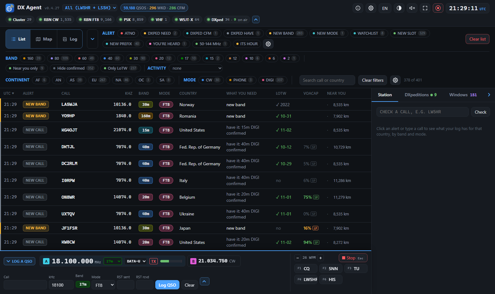
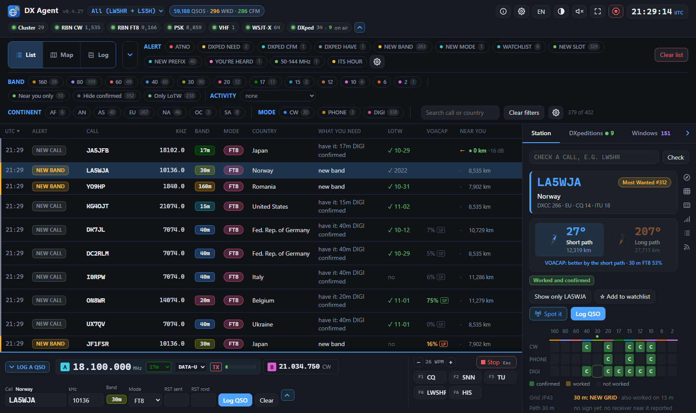
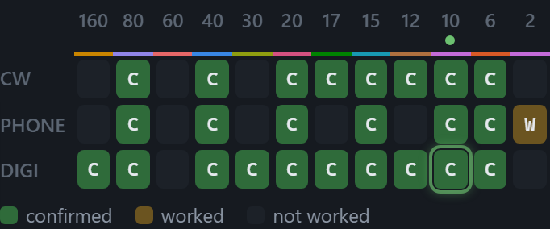
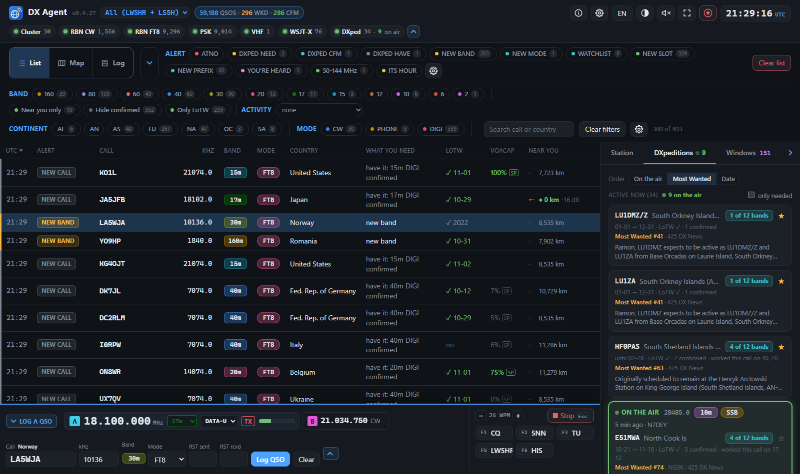
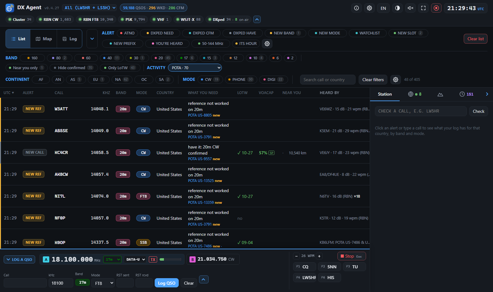
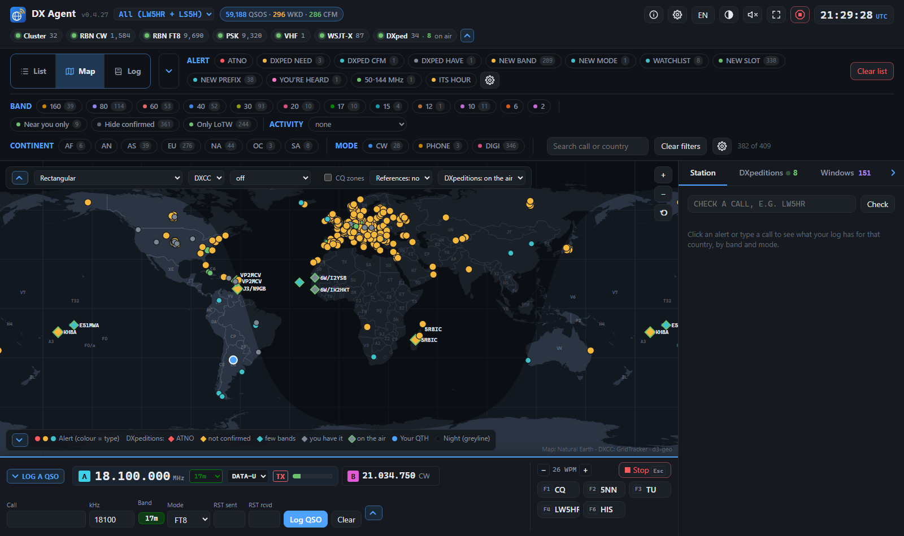
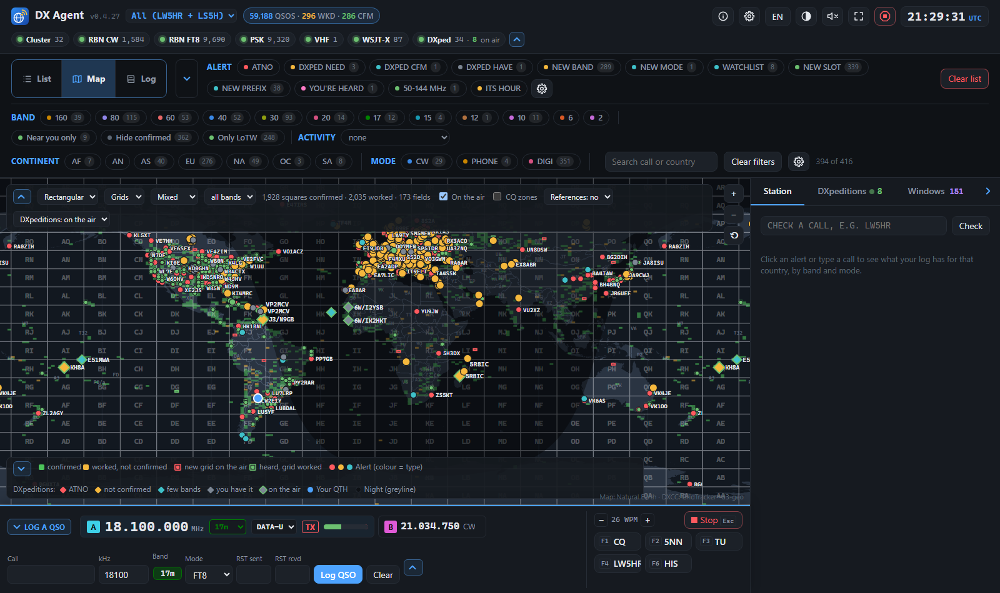

# DX Agent — User manual

*Version 0.4.21 · Made by Diego – LW5HR · Collaborators: **Javi – LU5FF** (QA Product Advocate), Franco – LU2PWY, Juan Pablo – LU9HVR, Gustavo – LU7HW, Daniel – LU1HLH · [Versión en castellano](MANUAL.es.md)*

DX Agent watches the DX cluster and the Reverse Beacon Network (RBN), checks every station
spotted against your log, and tells you when one you still need is on the air: a new country,
a new band or mode, a DXpedition that adds something, or a station on your watchlist. It runs
on your PC and you use it from your web browser.

Contents:

1. [What you need](#1-what-you-need)
2. [Install and open it](#2-install-and-open-it)
3. [First setup](#3-first-setup)
4. [The screen](#4-the-screen)
5. [Alerts](#5-alerts)
6. [Tune the radio and pass the call to your logger](#6-tune-the-radio-and-pass-the-call-to-your-logger)
7. [Let DX Agent see your QSOs at once](#7-let-dx-agent-see-your-qsos-at-once)
8. [DXpeditions](#8-dxpeditions)
9. [Activations: POTA, SOTA, IOTA...](#9-activations-pota-sota-iota)
10. [The map](#10-the-map)
11. [CQ DX Marathon](#11-cq-dx-marathon)
12. [LoTW](#12-lotw)
13. [DX Agent's logbook (experimental)](#13-dx-agents-logbook-experimental)
14. [Updating to a new version](#14-updating-to-a-new-version)
15. [Common problems](#15-common-problems)
16. [Help and contact](#16-help-and-contact)

---

## 1. What you need

- **Windows 10 or 11, Linux (x86_64) or a Mac (Apple Silicon or Intel).** The package brings
  everything it needs (Python included): nothing to install.
- **An internet connection**, for the spots and the DXpedition, country and LoTW lists.
- **Your log**, in one of two ways:
  - an **ADIF** file your logging program writes: Log4OM's backups, for example, or an ADIF
    export from any other logger;
  - or your **LoTW** account, if you have no ADIF file: DX Agent downloads every QSO you
    uploaded there;
  - or nothing yet, if you're starting from scratch: DX Agent creates a new log for you
    (section 3);
  - or **DX Agent's logbook** (experimental): DX Agent keeps your log itself, uploads it to LoTW,
    Club Log and QRZ.com, and downloads your LoTW and QRZ.com confirmations (section 13).
- Optional: your **LoTW password**, so DX Agent knows what you have confirmed even when your
  logger isn't synced with LoTW.

## 2. Install and open it

1. Download the latest `dx-agent-<version>-windows.zip` from the
   [Releases](https://github.com/lw5hr/dx-agent-download/releases/latest) page.
2. Unzip it wherever you like, for example in `Documents`. Your settings and data aren't kept
   there but in a folder of your own that every version uses (section 14): the program's folder
   can be replaced or deleted.
3. Double-click **start-dx-agent.bat**. The dashboard opens in your browser at
   **http://localhost:8073**.

If Windows shows a security warning the first time (the file came from the internet), choose
the option to run it (**Run**, or **More info → Run anyway**). To avoid it: before unzipping,
right-click the zip → **Properties** → tick **Unblock** → OK.

**How it runs:** without a window. While it runs, double-clicking start-dx-agent.bat again just
opens the dashboard (a newer version you open stops the old one and takes its place). To close it, use the **Stop** button at the top right of the dashboard. To
see what it is doing, use **start-dx-agent-console.bat**, which runs it in a console window.

You can bookmark the dashboard: `http://localhost:8073`. Only your PC can open it; other
computers on your network can't.

### On Linux

1. Download the latest `dx-agent-<version>-linux-x86_64.tar.gz` from the same
   [Releases](https://github.com/lw5hr/dx-agent-download/releases/latest) page.
2. Unpack it into a folder of yours and start it:

   ```sh
   tar -xzf dx-agent-<version>-linux-x86_64.tar.gz
   cd dx-agent
   ./start-dx-agent.sh
   ```

   The dashboard opens in your browser at **http://localhost:8073**, as on Windows.
   `./start-dx-agent-console.sh` runs it in the terminal, to see what it does.

### On a Mac

1. Download the latest `dx-agent-<version>-macos.tar.gz` from the same
   [Releases](https://github.com/lw5hr/dx-agent-download/releases/latest) page. It works on
   every Mac, Apple Silicon (M1, M2...) or Intel.
2. Double-click it to unpack it, and move the `dx-agent` folder wherever you like, for example
   Documents.
3. Double-click **start-dx-agent.command** in it. The dashboard opens in your browser at
   **http://localhost:8073**, as on Windows.

The first time, macOS says it can't open it, because it isn't signed by Apple. Open **System
Settings → Privacy & Security**, scroll down to the message about start-dx-agent.command, click
**Open Anyway** and confirm; then double-click it again. From then on a double-click is enough.
Or, in Terminal:

```sh
cd ~/Documents/dx-agent
xattr -dr com.apple.quarantine .
./start-dx-agent.command
```

Pop-ups go to the Mac's Notification Center (macOS may ask for permission the first time).

Log4OM, N1MM, DXLog.net and OmniRig are Windows programs: reading Log4OM's database and tuning
through them only work on Windows. The rest is the same on Linux and on a Mac (the UDP QSOs from
WSJT-X, tuning through flrig, Hamlib or TCI... included).

## 3. First setup

The first time, the dashboard shows a yellow bar, because it doesn't know where your log is
yet. Click **Settings** (top right) and fill in:

1. **Station**
   - **Callsign:** yours. It is used to log in to the cluster and the RBN.
   - **Your log:** an ADIF file, **LoTW only (no ADIF file)**, or **Start from scratch (a new
     log)**: DX Agent creates an empty log, `data\<CALL>.adi` in your DX Agent folder, and adds to it the QSOs your
     programs send it as you log them (WSJT-X, N1MM... see section 7). When you start using a
     logger, import that file there and choose ADIF file. Or **DX Agent's logbook
     (experimental)**, to keep your log in DX Agent (section 13).
   - **ADIF log:** click **Browse…** and pick the file. If you pick a dated Log4OM backup
     (`W1ABC_20261016_124613_backup.adi`), DX Agent turns it into `…/W1ABC_*_backup.adi`, so the
     newest backup is always used. **Test** shows which file it found and how many QSOs it has.
   - **Grid square:** yours (FN31, GF05pr...). Empty = taken from your log. It is used for the
     map, the beam heading and "near you".
   - **Your other callsigns** (optional; a contest call, say): **+ Add a callsign**, the call
     and its log: an ADIF file, or Log4OM's database itself (the `.SQLite` file, nothing to
     export). Alerts, DXCC and WAZ count all your callsigns together; the picker in the header
     can show just one.
2. **LoTW** (optional): your LoTW username and password, then **Test login**. The password is
   stored encrypted for your Windows user (on Linux and a Mac, readable only by you), never as
   plain text.
3. **Alerts:** which alert types you want, on which bands and modes. The defaults are a good
   start.
4. **Propagation:** your power, your antenna's gain and the noise where you are, for VOACAP's
   predictions; and the VHF openings on 6 m and 2 m (section 5).
5. **Radio:** the program that controls your radio (see section 6). If you don't
   want DX Agent to move your radio, leave it off.
6. Click **Save and apply**. No restart needed: within seconds it reads your log again (the top
   says "Reading your log…") and connects to the spot sources.

If something is wrong (an invalid callsign, no band picked...), a list appears in red next to
the button, and nothing is saved until it's fixed.

The settings are in tabs: Station, Log (only with DX Agent's logbook), LoTW, Alerts,
Propagation, Marathon, Spot sources, Radio and Other. Saving keeps what you changed by hand in
`config.toml` and the page doesn't show.

The dashboard follows your browser's language; the **EN/ES/PT** button in the header switches it:
English, Spanish or Portuguese (Brazil).

## 4. The screen



**Header:** your callsign (with several, a picker: **All**, or one alone to see what that one
still needs); one pill per spot source (green = connected, amber = connecting,
red = down): Cluster, RBN CW, RBN FT8, and PSKReporter, WSJT-X, TCI and VHF when you use them. **A
click on a source's pill** leaves only the stations that source heard (another click, or **Clear
filters**, shows them all again). The **DXpeditions** pill ("48 · 6 on the air": how many are
within their dates and how many were spotted in the last 15 minutes; a click opens their tab);
your log's totals: QSOs in blue, countries worked in amber, confirmed in green; icon buttons
(hover one to see what it does): **About** ⓘ, **Settings** ⚙, **EN/ES/PT**, **Theme** (a menu with
a preview of each: Auto, Light, Dark, High contrast dark and light, Solarized dark and light,
Nord, Dracula, Dracula orange, Alucard, Alucard black and Sepia), **Sound** (a beep for the important alerts, off by default), **Full
screen** (four corners; the **F** key too, F or Esc to leave) and **Stop**, in red; the UTC
clock. **About** tells what DX Agent is, who made it and its collaborators, and has the links to
support it, to the website, to this manual and to report a problem. On a narrower window the
pills go on a second line, and the chevron after them folds them to their status dots.

**Filters**, above the list, in three rows:

- buttons for **alert type** (only the types turned on in Settings), **band** and **mode** (none
  ticked = everything shows). Each option says how many stations it would show, with the other
  filters as they are: with 20 m picked, the modes say how many on 20 m;
- **Continent** (AF, AN, AS, EU, NA, OC, SA): keeps the stations
  from the continents picked, to stay with where your antenna points. Your own call spotted
  always shows;
- **Activity:** only POTA, SOTA, IOTA... activations (section 9);
- **Near you only:** only stations heard by someone near you. It only hides the others: they still alert. The
  setting **Only alert when heard near you** (Settings → Alerts) is different: with it, a station heard only far away
  never alerts, and where few receivers are near you the list stays almost empty (the dashboard then says how many
  didn't alert). Usually the filter is what you want. What your own WSJT-X decodes always counts as near
  (section 7);
- **Hide confirmed:** hides what you already have confirmed on that band and mode;
- **Only LoTW:** only stations that uploaded to LoTW in the last 12 months, and DXpeditions that
  announced LoTW;
- a **search** box for a callsign or country;
- **Clear filters** shows everything again. Your browser remembers the filters.
- **⚙** (next to Clear filters, or Settings → **Filters above the list**): which of Continent, Near you only, Hide
  confirmed, Only LoTW and Activity show. A hidden one is turned off. The alert types, bands and modes are the ones you
  alert on (Settings → Alerts).
- **Fold the filters:** the chevron next to **List** / **Map** folds them to one line that says what
  is picked ("FILTERS 20m · CW", highlighted while a filter is on), for more room for the list;
  the search, Clear filters, the count and Clear list stay. Your browser remembers it.

**The alert list:** one row per alert, newest on top, coloured by type. Columns: UTC time,
alert type, callsign, frequency, band, mode, country, **what you need**, LoTW, **VOACAP** (the
chance of a QSO this hour, section 5), **near you** and who heard it. New rows flash. When the station is spotted again on the same band and mode, its
row updates (time, frequency, who heard it, ×N): it shows where the station is now. Rows fade 10
and 30 minutes after the station's last spot there.

**Clear list** (in red, top right): empties the list, after asking. Whatever is still on the air
alerts again at its next spot. **One station only:** the **✕** next to its call (it shows with the
mouse on the row), or a right click on the row → **Remove from the list**.

**Pin a station:** the **anchor** next to the ✕ keeps it in the list on that band however long ago
it was spotted: neither **Take out of the list after**, nor Clear list, nor restarting DX Agent
takes it out. It goes on top whatever the order, with its anchor always in sight (in the skin's
colour), and stays on the radio's panadapter too. It leaves when you work it on that band, with
its ✕, or with another click on its anchor.

**Sort by a column:** click a column's header to sort the list by it: by frequency, by band, by
mode (CW, phone and digital together), by country... **Alert** and **What you need** put the
most wanted first, **LoTW** the latest uploads first. Click again for the other way round, and a
third time for newest on top again. An arrow shows the order. New alerts go into their place, and
the browser remembers the order.

**On the right, the Station tab:** clicking a row (on the call or on the frequency) opens the
station:

- a card with the call, its country, zones and **Most Wanted** rank on Club Log;
- both **beam headings**, large, each with its compass and distance: the short path in blue,
  the long path in orange;
- the band × mode grid of its country: green **C** = confirmed, amber **W** = worked, grey =
  missing. **Hover a C or W** for the QSOs that made it (call, date, mode, ✓ when confirmed):
  you see at once whether that 20 m QSO was this DXpedition or another station years ago;
- **where it's on the air now**, in that same grid: a **green ring** on each band and mode
  where it was spotted in the last 15 minutes, and a dot ● over the band. The cell of the
  **latest spot blinks**: that's where the station is now; the others keep a steady ring, and
  the blinking moves when it's spotted on another band. A DXpedition on several bands at
  once (S9R, say) shows a ring on each, with the latest one blinking. Hover a ringed cell
  for when, where and who spotted it; **click it to tune there** (with a radio set up, section 6). With no spot for 15 minutes, the ring goes. A ring on
  an empty cell: it's on the air on a band you need;
- whether you worked that exact call, its LoTW status and, for a DXpedition, its details;
- when the station said its grid locator on the air (your WSJT-X, RBN's FT8/FT4), its **grid
  square** and where you stand with it on the band it was spotted on: "Grid DN39 · 20 m: NEW
  GRID", or confirmed, and the other bands you worked it on. The band × mode grid above is the
  country's; this line is the square's;
- **the path**: whether your signal gets to the station's area and its signal gets to yours,
  from what was measured in the last 15 minutes (section 5);
- **Propagation (VOACAP)**: the next 24 hours by band, for CW, SSB, FT8, FT4 or RTTY, this hour
  marked; hover a square for its figures (section 5);
- with the CQ DX Marathon on, what it adds to the Marathon (section 11);
- for a station on a **POTA park or SOTA summit**, a card with what pota.app or SOTA say about
  it: name, type and place, how many activations and QSOs, who activated it first, its latest
  activations, whether **you** worked it and on which bands (or "New for you"), and links;
- **Who hears it**, the receivers nearest to you first, and **Check PSKReporter (FT8/FT4)** (or,
  with PSKReporter live, the receivers as they report it: section 5);
- **Show only** this call, **☆ Add to watchlist**, **Spot it** (below), its **Latest spots**, and
  links to QRZ.com, HamQTH and DXWatch. **Latest spots** and **Who hears it** are pills: hover one
  to see what it lists;
- a strip of **icons at its right**, one per section: a click hides that section for every
  station, another shows it again. Your browser remembers which.

WWFF, IOTA and COTA references get a card too, as POTA and SOTA.

**Spot it** (the antenna button) posts a DX spot of the station on the DX cluster DX Agent is
logged in to, as your callsign: `DX 14025.0 3Y0K up 2`, say. It opens a small form with the
frequency of the row you clicked (you can change it) and a comment (up to 30 plain characters),
and asks you to confirm. Then it says whether the cluster took it: **posted** when the cluster
sends it back, **sent** when it doesn't (W3LPL, for example), or what the cluster answered if it
refused it. At most one spot every 30 seconds; with the cluster off or down the button is grey.





**The DXpeditions tab:** see section 8. **The Marathon tab:** see section 11. Clicking a country
on the map shows that country in the Station tab (section 10).

**Fold the panel:** the chevron right of the tabs folds the panel on the right to a strip of
their icons, with the DXpeditions on the air and the Marathon score still showing; a click on an
icon opens it at that tab. While it is folded, hovering over a row of the list shows that
station's card: its country, status and band × mode grid. Your browser remembers it.

**List / Map / Log:** to the left of the filters, switches between the list, the map (section 10)
and, with DX Agent's logbook, your log (section 13).

## 5. Alerts

| On the dashboard | What it means | By default |
|------------------|---------------|------------|
| **ATNO** | A country you never worked | on, with a Windows pop-up |
| **DXPED NEED** | An active DXpedition that adds a country, band or mode | on |
| **DXPED CFM** | A DXpedition from a country worked but not confirmed on that band or mode | on |
| **DXPED HAVE** | A DXpedition you already have confirmed on that band and mode (grey) | on |
| **NEW BAND** | Country worked, but not on this band | on |
| **NEW MODE** | Country worked, but not in this mode (CW, phone, digital) | on |
| **WATCHLIST** | A call on your watchlist | on |
| **NEW SLOT** | Country not worked on this band and mode combination | off |
| **NEW GRID** | A grid square not worked on this band, any mode (VUCC, FFMA). Only spots that say the locator can alert: your WSJT-X's decodes and RBN's FT8/FT4 (section 10) | off |
| **NEW PREFIX** | A prefix you have never worked, on any band or mode, as the CQ WPX award counts them (LU1ABC: LU1; N8BJQ/KH9: KH9). Far fewer than NEW CALL | off |
| **NEW CALL** | This exact call isn't in your log (lots of alerts) | off |
| **MARATHON** | A country or CQ zone you haven't worked yet in the CQ DX Marathon (section 11) | on, while you follow the Marathon |
| **YOU'RE HEARD** | Your own call spotted, on any band and mode, by the cluster, the RBN or, with PSKReporter live, a PSKReporter receiver: the row is highlighted in pink and says how far away and in which country the receiver is ("heard 8,912 km away, in United States"). Click it for every receiver that heard you, on the map too | on |
| **50 MHz**, **144 MHz** | 6 m or 2 m open around you (see VHF openings, below); highlighted in green | off |
| **ITS HOUR** | At the top of each UTC hour, a country you need that is usually heard near you at that hour (see Ventanas, below) | on |

- **Notices at the top right:** the alerts at your pop-up level (Settings → Windows pop-ups; by
  default ATNO only), every VHF opening, a 2 m duct and a DXpedition coming on the air also show at
  the top right of the dashboard, one under the other. Each stays 2 minutes (not while the mouse is
  on it), with its ✕ and **Close all**; a click takes you to the alert's row, its station's panel
  open.
- **What you need** says exactly what the station adds: "new band", "17m DIGI never worked",
  "grid EN52 never worked on 6m", "entity not confirmed", or "have it".
- **Confirmed** means LoTW or paper QSL, as in the ARRL's DXCC (eQSL doesn't count). Only the
  current entities count: a deleted one that old QSOs carry (85 Netherlands Antilles, as LoTW
  reports it) is in no total, the header's worked and confirmed either.
- **LoTW** says whether the station uploads to LoTW (and its last upload), whether the
  DXpedition announced LoTW, or "no LoTW".
- **Near you:** green **● 732 km · 7 dB** = heard by a receiver within your "near" radius (1,500
  km by default); in grey, the distance to the nearest receiver; **—** = nobody reported it in
  the last 15 minutes. Before the distance, **the path**, from what was measured in the last 15
  minutes on that band: **⇄** (green) both ways, **→** (green) your signal was reported near the
  station, **←** (amber) the station gets here but your signal hasn't been reported there yet, a
  faint **·** nothing measured yet. It is a measurement, not a prediction: the more you transmit
  (a few CQs on FT8), the more it knows. The Station tab says it in words.
- The same alert isn't repeated for 15 minutes (change it in Settings), not even after saving
  Settings or opening DX Agent again: the station is listed again as it is spotted, but doesn't
  pop up or beep a second time.
- **RBN alerts: wait for a second skimmer** (Settings → Alerts, on by default): a station heard by
  one RBN skimmer only alerts once another skimmer, or someone on the cluster or PSKReporter,
  hears it too (a few minutes at most), so a skimmer's busted call (P9DX as an ATNO) doesn't
  alert. Cluster spots, posted by people, and active DXpeditions alert at once. Off: they all
  alert at once, marked **?**.
- **An alert type turned off in Settings also leaves the list:** an alert only for it goes, and
  one with another reason shows that one (NEW BAND rather than NEW CALL).
- An alert can be of several types: a NEW BAND that is a new grid square too shows under the
  **NEW GRID** filter, and with that filter picked the row says NEW GRID.
- Settings → Alerts also has **Keep only the latest row of each station** (same call,
  frequency and mode) and **Take out of the list after** N minutes without a spot (0 = never):
  both off by default.
- The list keeps the last 500 alerts. When it's full, NEW CALL ones leave first; the others
  stay at least an hour.
- When you work the station, its alerts in the list change by themselves: a NEW SLOT you worked
  isn't one any more (nor under that filter), a DXpedition becomes DXPED CFM or DXPED HAVE, and an
  alert that adds nothing now shows as **WORKED**, in grey.
- **Windows pop-ups** are shown for ATNO only by default; in Settings you can turn them on for
  more types. Clicking one opens the dashboard at that station.

**Watchlist:** calls you always want to hear about, even if they add nothing. Wildcards work,
for example `VP8*`. Edit it in Settings or with the ☆ in the Station tab. **Ignore** does the
opposite: those calls never alert. In the filters, **WATCHLIST** with another type shows only the
calls you follow that are also that type: **WATCHLIST** + **NEW SLOT** is your watchlist on a band
and mode you still need.

**PSKReporter live:** in Settings → Spot sources → **PSKReporter** you can pick **When you ask**
(one query every 5 minutes, with the Station tab's button; the default) or **Live (MQTT)**:
PSKReporter's reports as they arrive, with no limit, for the station open in the Station tab and
the digital alerts in the list. Their receivers count for "near you" and the map without a button,
and a **PSKReporter** pill in the header shows the connection. It needs your grid square. With
**Only alert when heard near you**, a digital station kept back for being heard only far away
alerts as soon as a PSKReporter receiver near you reports it on that band. Your own calls are
followed too: each receiver that reports you is a **YOU'RE HEARD** row, with its SNR and distance.

### The prediction: VOACAP

The path says what is measured; **VOACAP** says what to expect: the month's median ionosphere at
that hour, between you and the station, both ways (your signal there and theirs here). It is
built in (VE3NEA's DVOACAP, in Python: nothing to install), and the sunspot number is NOAA's,
downloaded daily. It needs your grid square. In **Settings → Propagation** set your power, your
antenna's gain (about 3 dBi for a dipole or a vertical, 8 to 10 for a Yagi) and the noise where
you are (residential, rural or quiet).

- The **VOACAP** column in the list: the chance of a QSO on the row's band and mode this hour,
  green from 50%, amber from 10%; hover it for the SNR each way and the MUF. For FT8 and FT4 it
  also gives the SNR as WSJT-X reports it, to compare with the reports you get. VOACAP stops at
  30 MHz: nothing on 6 m and up.
- **Propagation (VOACAP)** in the Station tab: the next 24 hours by band, this hour marked, for
  CW, SSB, FT8, FT4 or RTTY.

It is a prediction, the month's median: on a given day the band can be better or worse; the path,
when something was measured, says what is happening now.

### VHF openings: 6 m and 2 m

**Settings → Propagation → VHF openings** watches PSKReporter's live reports and puts a **50 MHz**
or **144 MHz** alert in the list when the band opens around you. It needs your grid square. Two
ways, each turned on by itself:

- **Stations near you hearing far ones:** several stations near you hear several stations in one
  place (a country, a continent or a grid field). Good where there are active stations around you.
- **Stations hearing you:** several far stations in one place report you. Only while you transmit
  (FT8, FT4, CW...); good where no one else is on.

What you need says it ("open to Japan: 3 near you hear 2"). An opening alerts once; its row
follows it and says "closed" when the reports stop. The **VHF** pill counts the openings open now.
Every number (how many stations, how far, for how long) is a setting.

- **What it probably is:** each row starts with its kind: Es, multi-hop Es, F2, TEP (evening or
  afternoon), tropo, aurora or meteor scatter, by the band, the distance, whether the path crosses
  the geomagnetic equator, the Kp and the month's sunspots. A label only: it doesn't decide whether
  it alerts.
- **Space weather:** the **VHF** pill shows NOAA's Kp, A index and solar flux, the Kp in red during
  a storm (Kp 5 or more). **☄ MS** blinks within two days of one of the ten main meteor showers'
  peak.
- **A row leaves the list** 45 minutes after its last report (a tropo one, 60), fading meanwhile; a
  pinned one stays.
- **On the map:** each opening's latest paths in its colour, the points where the Es bounces grouped
  into clouds, and tropo as a wide corridor.
- **2 m tropo from the forecast** (turned on by itself): once an hour, Open-Meteo's forecast for
  your QTH and 24 points around it says where there is a duct before the band is heard. A duct over
  you, or at two points of one bearing, alerts once (a Windows pop-up, the sound and a notice) and
  the pill shows **≋ TROPO**; at one point only it is a possible one, **≋ TROPO?** in yellow, with
  no sound. One against the ground and thin (over the sea in the afternoon) is no use on 2 m: shown,
  never told. With the **VHF** pill on, the map shows the points and a line from your QTH to each
  duct ("NE 400 km").

### Ventanas: when each country you need is heard

The **Ventanas** tab counts, by UTC hour, band and mode, on how many days each country you still
need was heard near you: the spots from the cluster, the RBN, PSKReporter and your WSJT-X heard within
your "near you" distance.

- **One row per country,** with its 24 hours as a line of bars and its Club Log **Most Wanted** rank.
  **Order:** A–Z, Most Wanted or This hour. A country with a spot in the last 15 minutes is green.
- **Click a country** for every band and mode hour by hour: solid where it was heard, faint where
  VOACAP predicts it.
- **The ITS HOUR alert:** at the top of each UTC hour, the country you need that is heard the most at
  that hour, if it was heard on 2 days or more (within the last 45). It takes a few days of counting;
  until then, filtering by ITS HOUR says why the list is empty. Set up in Settings → Ventanas.

## 6. Tune the radio and pass the call to your logger

With a radio set up (Settings → **Radio (Tune button)**), clicking an alert's **frequency** has
your program move the radio there, and the station opens on the right. The Station tab also
has a **Tune** button. A message at the top right says whether it worked.

| Program | What to do in the program | Mode too? |
|---------|---------------------------|-----------|
| **Log4OM 2** | Settings → Software integration → Connections → turn on **Remote control** (port 2241) | yes, when Log4OM uses OmniRig |
| **N1MM Logger+** | doesn't tune (see below) | — |
| **DXLog.net** | doesn't tune (see below) | — |
| **OmniRig** | pick OmniRig's rig 1 or 2 in DX Agent | yes |
| **Hamlib (rigctld)**, the one to start with | have rigctld running, or let DX Agent start it (below) | yes |
| **flrig**, **DXLab Commander** | don't tune (see below) | — |
| **TCI** (AetherSDR for FlexRadio, ExpertSDR, Thetis) | AetherSDR: Settings → **Autostart TCI with AetherSDR** (or **Enable** in its TCI applet, port 50001) | yes |

- **Hamlib, the one to start with.** It tunes, sets the mode and the split, and reads the radio
  back for the Log view: frequency, mode, TX, split and S-meter.
  - **Its `rigctld` must be running.** Tick **Start rigctld with DX Agent** and type its arguments:
    your radio's model, its COM port and its speed, for example `-m 3068 -r COM7 -s 19200` for an
    IC-9100 (`rigctl -l` lists the models). DX Agent starts rigctld with itself and closes it when it
    stops, and adds `-C cache_timeout=0` so the PTT is read from the radio (if you start rigctld
    yourself, add it to its arguments).
  - **A COM port takes one program at a time**, so that radio can't be on OmniRig as well.
- **Two radios.** Settings → Radio has a **Radio 2** under Radio 1, with its own program, address
  and name.
  - **Only one of the two can be on TCI.** Two on Hamlib need a rigctld each, on its own port.
  - **The active radio** is the one you last tuned or transmitted on, or the one you click in the
    Log view (section 13). The alert list's frequencies tune it, and the Station tab has a Tune
    button for each radio.
  - **Both on N1MM or DXLog.net (SO2R):** each radio gets its own radio number.

- **With Log4OM, the callsign is filled in too**, in its QSO window, ready to log. If you typed a
  call there yourself, Log4OM keeps yours.
- **With Log4OM, the mode** changes through OmniRig, the program Log4OM uses to control the
  radio: with **Also set the mode** ticked, DX Agent uses the OmniRig rig that is on-line and
  Log4OM follows it. If Log4OM controls your radio another way, only the frequency changes.
- **Radios that need their data mode for FT8** (an IC-9100 in USB-D, for example): put the
  radio in USB-D once. From then on, clicking FT8/FT4 spots moves only the frequency and leaves
  USB-D on. A phone spot switches to USB or LSB, and the next FT8 spot stays in USB: put USB-D
  back by hand. The same goes for CW: a radio in CW or CW-R keeps it.
- **FlexRadio with AetherSDR (TCI), in testing:** Tune moves the slice that transmits (the TX
  slice; until DX Agent knows which one, the one with the focus) and sets the mode (CW, USB/LSB,
  RTTY, DIGU for FT8). With two or more slices open, the Station tab has a Tune button per slice:
  its letter (or its RX number, until it has had the focus) and where it is now; the TX slice is
  marked **TX**, and the one the list's frequencies tune stands out. Choosing a slice there tunes
  it but doesn't give it the focus in AetherSDR: AetherSDR doesn't let another program change
  it. With **Show the alerts on the radio's panadapter (TCI)** (on
  by default), each station of the list shows on AetherSDR's panadapter in its colour, with its
  headline and country; it moves when the station changes frequency and leaves when it's no
  longer spotted. Every alert goes, those of the band the radio is on first; when you change band
  they are sorted again. A station you then work leaves the panadapter, or stays in grey with
  **Leave the stations you then work on the panadapter, in grey**. A click on one tunes there and
  opens it in DX Agent's Station tab. A **TCI** pill in the header shows the connection and how
  many alerts are on the panadapter; a click on it leaves in the list the alerts on the
  panadapter. If you open AetherSDR after DX Agent, Tune connects right then. Tested with
  AetherSDR's demo radio; if you use it with a Flex, tell us how it went in
  [issue #10](https://github.com/lw5hr/dx-agent-download/issues/10).
- **Never while you transmit.** Before each change of frequency, band, mode or VFO, DX Agent checks
  that the radio is receiving; if it transmits, or the program can't say, it doesn't move it. So
  **N1MM, DXLog.net, flrig and DXLab Commander no longer tune**: their connection doesn't say
  whether the radio transmits (QSOs from those loggers still come in). With Log4OM, frequency and
  mode go through OmniRig; without OmniRig it doesn't tune. It isn't an absolute interlock:
  transmission can start between the check and the command.
- **Split:** when a station's spots say where it listens (**UP 5**, **UP 1-3**, **QSX
  14.205**...), Tune puts the radio in split, and the message says it ("split: TX 14026.0 kHz"):
  AetherSDR opens a second slice that transmits there (TCI); through OmniRig and Hamlib, the
  station's frequency goes to VFO B. **UP** alone goes up 1 kHz on CW and RTTY, 5 on phone (you can
  change it). The next Tune to a station without split ends it, whoever set it (WSJT-X or you too).
  Not on FT8 and FT4. Settings → Radio → **Split when the spot says so**, on by default.
- **Not while transmitting (TCI):** a Tune while the radio is on the air doesn't move it, nor
  give WSJT-X a new call. Settings → Radio → **While transmitting**: don't tune (the default), tune
  when the transmission ends, or tune anyway. DX Agent never keys the radio.
- **WSJT-X:** tick **Also send the call to WSJT-X** in DX Agent, and in WSJT-X tick Settings →
  Reporting → **Accept UDP requests**. Clicking an FT8/FT4 spot puts the radio on the FT8/FT4
  frequency, fills in **DX Call** and **DX Grid**, and moves the audio to the station's
  frequency; you click **Enable Tx**. With TCI, WSJT-X's slice is the one that moves, so WSJT-X
  follows a band change.

## 7. Let DX Agent see your QSOs at once

DX Agent reads your log file at start and whenever it changes. But many loggers write that file
only now and then (Log4OM makes a backup every so often), and meanwhile a station you just
worked keeps alerting. To avoid that, your logger can tell DX Agent each QSO as you save it:

- **Log4OM 2: nothing to do.** DX Agent reads the new QSOs straight from Log4OM's database,
  every 10 seconds.
- **Other loggers, over UDP:** in your logger, add the destination `127.0.0.1`, port `12065`,
  next to the ones you already have. That port is in Settings → Other → **UDP port for logged
  QSOs**, under "Check the log file every". It isn't the dashboard's port (8073) nor the radio's
  (TCI's 50001, say): don't mix them up.

| Logger | Where |
|--------|-------|
| **N1MM Logger+** | Config → Configure Ports… → **Broadcast Data**: tick **Contacts** and add `127.0.0.1:12065` |
| **DXLog.net** | Options → Configure network: QSO broadcast `127.0.0.1:12065`; Options → Broadcast: QSO and **Use N1MM QSO format** |
| **HRD Logbook** | Tools → Configure → QSO Forwarding → **UDP Send**: `127.0.0.1`, port `12065` (not tested with HRD yet) |
| **WSJT-X / JTDX** | for their QSOs, usually not needed: your logger gets them and passes them on to DX Agent. Needed for what they decode (below) |

- **Loggers without UDP** (DXKeeper, Logger32, N3FJP...): if they write an ADIF file as you log
  (or export one automatically), add that file in Settings as a second log file, under the
  main one.

When a new QSO comes in, the alerts already listed update by themselves and stop saying "new
band" once you've worked it. QSOs received over UDP are kept until your log has them: closing
DX Agent before that doesn't lose them.

### What your WSJT-X decodes

If WSJT-X (or JTDX) sends its messages to DX Agent, each station you decode is one more spot, like
a cluster one: if it's something you want (a new country, a new band, your watchlist...) it shows
in the list even if no one spotted it. It counts as heard **0 km from you**, so the **Near you
only** filter always shows it. The row says your call, the SNR and the message (WSJT-X), and a
**WSJT-X** pill in the header shows the decodes coming in.

It comes on the same port as the QSOs. WSJT-X sends to one destination (Settings → Reporting → UDP
Server), so if another program already uses it (Log4OM, JTAlert, GridTracker):

- **a multicast group:** in WSJT-X, UDP Server `239.255.0.1`, port `2237`; in DX Agent,
  Settings → Other → **UDP port for logged QSOs** `2237` and, next to it, the multicast group
  `239.255.0.1`. DX Agent and the programs that join groups (GridTracker, JTAlert) hear it at
  once;
- or **the program that already gets it forwards it** to `127.0.0.1:12065` (JTAlert and
  GridTracker can resend WSJT-X's messages).

The station you call in WSJT-X (a double click on its decode) opens in DX Agent's Station tab:
what you have of its country, the path, VOACAP... Decodes of the period in which you change band
don't count on the new band.

## 8. DXpeditions



The **DXpeditions** tab shows the active ones and those starting in the next 30 days,
gathered from NG3K, 425 DX News and Club Log.

- Each card says what it adds: **ATNO**, **Not confirmed**, or how many bands you have (for
  example "3 of 10 bands").
- **ON THE AIR** (green frame) = spotted in the last 15 minutes, with its frequency (click to
  tune).
- **Order:** **On the air** (the ones transmitting first), **Most Wanted** (the most wanted
  country on Club Log first) or **Date**.
- **only needed** hides the ones you have on most bands (those on the air still show).
- **When one ends:** once its announced end date has passed, DX Agent reads the sources again
  before taking it off the list. If one of them extended it, it stays with the new date.
- When you open a DXpedition that uploads its log to Club Log, DX Agent looks for your call in
  their log: it shows the bands and modes you're in, and warns you if a QSO of yours isn't in
  theirs.

## 9. Activations: POTA, SOTA, IOTA...



The **Activity** menu (next to the mode filters) shows only activations: **POTA, SOTA, IOTA,
WWFF, BOTA, COTA** (castles), **LOTA** (lighthouses), **TOTA, ROTA, JOTA, YOTA** and **EME**, with
how many stations are on in the last hour. Its first option, **none**, turns the Activity filter
off.

- With an activity picked, the list also shows its spots that made no alert (**SPOT** rows),
  such as a park in a country you already have. One row per station, band and mode (the latest
  spot, **×N** how many), grey if it adds nothing, in colour if it still adds something.
- Each row shows the reference (`POTA US-5584`, `SOTA W7A/MN-001`...). Hover over it for the
  park's or summit's name, and for summits their altitude and points.
- **NEW REF:** with an activity picked, a summit, park, island or castle you haven't worked
  **on that band** is marked new, even if you have the country confirmed. DX Agent knows what
  you worked from the references in your log and from your QSOs with activators it saw on the
  air (since you started using it).
- On the map, with an activity picked, summits are mountains and parks are pine trees, at their
  real location: red if you haven't worked that reference, amber worked, green confirmed. With no
  activity picked they are a dot like any other station.
- **The References tab** (it shows while an activity is picked): every summit, park, island and
  castle you worked (POTA, SOTA, WWFF, IOTA, WCA), program by program: how many worked, confirmed
  and confirmed by paper QSL, and each one with its name and place, the bands, **C** confirmed /
  **W** worked and your latest QSO. You can see all of them, the confirmed ones, those with a
  **QSL** (paper card) or the unconfirmed ones. Click one for **your QSOs with it** (call, date,
  band, mode, ✓ confirmed in LoTW, ✓ QSL by card) and, for POTA or SOTA, its card. *Confirmed* means the QSO is confirmed in LoTW or by QSL;
  each program's own credit is on its site (pota.app, sotadata, wwff.co).

## 10. The map



Click **Map** (next to **List**). The filters work the same as in the list.

- **Dots:** alerts, coloured by type. **Diamonds:** active DXpeditions (green frame = on the
  air). **Mountains and pine trees:** summits and parks. **Blue dot:** your QTH.
- A dot fades 10 minutes after the station's last spot and more after 30: a faded dot is where
  it was, not where it is. Hover it to see how long ago.
- The shaded area is where it's night (its edge is the grey line).
- Picking a station draws the path from your QTH, with heading and distance, and the receivers
  that heard it.
- **Click a country** (or near a small island): the Station tab shows it as a lookup does: its
  card, the beam headings to its centre, its status and grid.
- Mouse wheel or **+ / −** to zoom, drag to move, **⟲** for the whole world. Dragging east or
  west goes round the world (past the Pacific, the map continues on the other side).
- **Rectangular / Azimuthal** (the first menu in the map's bar): the azimuthal map is centred on
  your grid square, so the short path to any station is a straight line from the centre: its
  beam heading is the angle, north up, and its distance the radius, with circles every 2,500 km.
  Under the mouse, a dashed line says the heading and distance to that point. Everything else
  (DXCC, WAZ, Grids, the alerts, the night) works as on the rectangular map. It needs your grid
  square.
- **DXCC** (top left) paints each entity by your award standing: green = confirmed, amber =
  worked, red = missing. Pick Mixed, Phone, CW, Digital, one band, Satellite or the Challenge.
- **WAZ** paints the 40 CQ zones the same way, with its variants (by mode, by band, 5BWAZ...).
- With one band (or mode) picked in the filters above, DXCC and WAZ paint that band ("12 m
  (filter)"), unless you picked one in their own menus.
- **Grids** (in the same menu as DXCC and WAZ): the Maidenhead grid, as GridTracker shows it.
  The 324 fields (FN, GF...) with their names and, zoomed in, the squares (FN31) with theirs. The
  squares you worked are painted: green confirmed, amber worked. Pick the mode (Mixed, Phone, CW,
  Digital or Satellite) and the band: **6 m** for FFMA, one band for VUCC. The summary says how
  many squares are confirmed, worked, and in how many fields. It follows VUCC's rules: confirmed
  means LoTW or a paper QSL (not eQSL), and repeaters and internet links never count. The square
  is the one your logger saved with the QSO (and each one in VUCC_GRIDS, for a station on a line
  or a corner); a QSO saved without a locator counts for no square.
- **On the air** (in the Grids view, ticked by default): the stations heard with a locator in the
  last 15 minutes, alert or not, in their square: those your WSJT-X decodes and RBN's FT8/FT4
  spots, on the bands and modes you alert on. Outlined **red**: a square you haven't worked on
  that station's band; green: one you have. Click one to open it in the Station tab, with its
  frequency and the beam heading to its square.
- Hover a square for what you have there in the band and mode picked (each band, its modes, ✓
  confirmed) and who is on the air in it.
- **References** (next to DXCC / WAZ): your POTA parks and SOTA summits, green confirmed, amber
  worked. Click one for its card, its beam heading and distance, and your QSOs with it, in the
  Station tab.
- **DXpeditions** (next to DXCC / WAZ / References): which diamonds show: those **on the air**
  (the default), those **needed**, **all** the active ones, or **no**. The station open in the
  Station tab always shows.
- Several DXpeditions at the same place (four at Koror, Palau, say) sit on a small ring around
  it, so each one can be clicked.
- **Fold:** the bar at the top (DXCC / WAZ / Grids and their menus) and the legend at the bottom
  each have a chevron that folds them to one line, to give the map more room. The browser
  remembers it.



## 11. CQ DX Marathon

The [CQ DX Marathon](https://dxmarathon.com) scores one point for each country and one for each
CQ zone you work: in the year (January 1 to December 31) or in the **Sprint**, ten days in
October. To follow it: Settings → **CQ DX Marathon** → **Track the countries and CQ zones I
work**; pick the year or the Sprint (with its dates), the modes your entry counts (all, one, or
**Classic**: CW and SSB) and, if you have several callsigns, which ones count (up to 2, as the
rules allow).

- **The Marathon tab** (next to DXpeditions) shows the period, your score (countries + zones),
  the 40 CQ zones (green = worked) and the countries: **Worked**, with the QSO that counts (click
  it to open the station), or **Missing**, with a search box. The tab's number is your score.
- **MARATHON alert** (purple): a station that adds a country or a zone, even in a country you
  have confirmed for DXCC. Country and zone alerts can be turned off separately. The MARATHON
  filter and the tab only show while you follow the Marathon.
- **Countries:** the CQ DX Countries List: the DXCC entities plus Sicily (IT9), African Italy
  (IG9/IH9), Shetland (GM/s), European Turkey (TA1), Bear Island (JW/b) and 4U1VIC.
- **Zones:** the QSO's zone in your log, else the call's. A US, Canadian or Russian station can
  be in another zone than its call says.
- DX Agent doesn't submit your entry: at the end, upload your ADIF at
  [entry.dxmarathon.com](https://entry.dxmarathon.com).

## 12. LoTW

- **Who uploads to LoTW:** DX Agent downloads the ARRL's public list every day and shows, in
  each alert, whether the station uploads to LoTW. No password needed.
- **Your confirmations:** with your LoTW username and password (Settings → LoTW → **Download my
  LoTW confirmations**), DX Agent downloads your confirmed QSLs every 12 hours, so "confirmed"
  stays current even if your logger isn't synced. The first download can take a few minutes; if
  LoTW is busy or doesn't answer, DX Agent tries again by itself every 10 minutes and carries on
  where it stopped.
- **LoTW as your log:** with no ADIF file, choose Settings → Station → **Your log** → **LoTW
  only (no ADIF file)**. Only what you uploaded to LoTW counts.
- **Several callsigns:** one LoTW account with every callsign's certificate is enough: each
  callsign takes its own confirmations.
- **Uploading to LoTW** from DX Agent: with DX Agent's logbook (section 13).

## 13. DX Agent's logbook (experimental)

DX Agent can keep your log itself, instead of reading your logger's file: Settings → Station →
**Your log** → **DX Agent's logbook (experimental)**. Its options are in Settings → **Log**.

- **Each of your callsigns has its own logbook**, with every field of every QSO. They never mix
  (each uploads as its callsign); alerts, DXCC and WAZ still count them together.
- **Import your logger's ADIF once:** Settings → Log → **Import ADIF…**, or **Import QSOs…** in
  the Log view's **Actions** tab (with All, you pick which callsign). Only that callsign's QSOs go in, and
  a QSO already there is skipped. A backup is made first, and one every day (the last 10, in
  `data\backups`).
- **To go back to a backup**, import its `.zip` the same way: the QSOs that are missing come back
  in.
- **Backups in the cloud:** Settings → Log → **Backups** picks the folder (**Browse…**, or the
  **OneDrive**, **Google Drive** or **Dropbox** buttons if they're on your PC), how many hours apart
  and how many to keep. In a OneDrive, Google Drive or Dropbox folder, its program uploads them to
  the cloud. **Back up now** makes one at once. If the folder isn't there (the drive isn't
  connected), the backup goes to `data\backups`.
- **New QSOs** come in over UDP from your programs, as before (WSJT-X, N1MM, Log4OM... section 7),
  with DXCC, country, zones and continent added, or from the form at the top of the **Log view**.
- **Quick log, in the List view:** under the filters, a folding form to log a QSO without going to
  the Log view: call, date and time, kHz, mode and RST. It fills from the station you pick and the
  radio, with 599 or 59 by mode. What it says when you log goes under it in a pill, green (red when
  it wasn't logged), with its ✕; a green one goes by itself after 20 s.

**The QSO form**, at the top of the Log view: it fills itself when you pick a station in the list or
on the map (the call, its grid square, the park or summit), with the frequency and mode your radio
is on (through OmniRig, Hamlib or TCI; in split, where you transmitted and where you received). The date and time follow
the clock until you type them, so the QSO is logged at the time you save it. A call typed by hand
shows its station once you stop typing. **Esc** in the call clears it, and what DX Agent filled for
that station. **Log QSO** (there or in the Station tab) saves it and says what it adds to your log
("new band"). The RST is filled for you: 59 on phone, 599 on CW. With more than one callsign,
**Your call** picks which logbook it goes into. It also has **Name**, **QTH**, grid square,
**References** (park, summit, island) and **Comment**; **Now** sets the date and time to this
moment and **Clear** empties the form. Its station shows in the side panel's **Actions** tab:
callbook, the **earlier QSOs** with it, and **This call**, a table of the bands and modes you
worked it on (**✓** green confirmed, amber worked, **NEW** a band and mode still new for its
country).

**The radio's box**, to the right of the form, shows your radio the way AetherSDR shows a slice.
- **The VFO the form follows** is large, with its letter in its colour (A cyan, B magenta, C green,
  D yellow), **TX** on the one it transmits on (filled red while it does), **SPLIT**, and its band
  and mode.
- **On TCI and Hamlib, an S-meter** shows under the frequency.
- **The other VFO**, or AetherSDR's other slices, show under it, one line each.
- **A click on the other VFO's line puts the radio on it**, through Hamlib, or OmniRig where the
  radio's file allows it (a TS-590 does, an IC-9100 doesn't). Through Hamlib, DX Agent reads both
  VFOs once when it connects (a blink on the radio's display), and then that line shows where the
  VFO was the last time the radio was on it.
- **The band and the mode are lists that change them on the radio.** A band takes it back where it
  last was on it, in its mode then; the first time, to CW, SSB or FT8 by the mode it is in. A mode
  (CW, LSB, USB, DATA, RTTY) keeps the frequency.
- **With two radios** they show side by side, with the active one's name in colour; a click on the
  other one makes it the active one.

**Callbooks:** name, QTH and grid square from **QRZ.com**, **HamQTH** or **QRZCQ**, with your own
account on each (Settings → Log). **Ask first** picks the one asked first: HamQTH, say, if you have
no QRZ.com subscription.

**The Log view** (next to List and Map): your log, newest first, with a search by call, a sort by
any column (click its header), and filters in the side panel's **Actions** tab (shown only in the
Log view), one under another: **Band**, **Mode** (CW, phone,
digital, FT8, FT4, RTTY), **Country**, **Date** (from and to), **LoTW** (confirmed, the last
download, uploaded not confirmed, not uploaded), **Club Log** (uploaded, to upload again, rejected,
not uploaded) and **QSL card** (received, sent not received, none). A click picks a choice and
another click takes it off; each says how many QSOs it would show with the other filters as they
are (with 20m picked, the modes say how many on 20m). The country is found by its name (as your log
writes it: "Spain") or by a prefix (`LU`, `VP8`, `3Y`, `LU5`). **Clear filters** takes them off.
A strip of icons at the tab's right goes to each part, with a dot on those that have a filter on.

The **LoTW** and **CL** columns say where each QSO stands: in LoTW, **✓** confirmed and **↑**
uploaded; in Club Log, **↑** uploaded, **↻** to upload again (you edited it) and **✗** rejected (the
reason, with the mouse on it).

A click on a QSO shows its station in the Actions tab; **✎**, a double click or **Edit this QSO** edits
it (**Save changes**), **✕** deletes it once you confirm. A deleted QSO is kept aside in the
logbook, in case it was a mistake, and it isn't deleted from LoTW, QRZ.com or Club Log.

**Uploads and downloads**, in the Actions tab, each with how many QSOs will go and a progress box
under the buttons. Each button shows only once its service is set up:

- **Upload to LoTW:** DX Agent runs **TQSL**, which signs the QSOs with your certificate and uploads
  them. TQSL must be installed, with your certificate and a Station Location for each callsign
  (Settings → Log → **Station Location**). TQSL keeps your passphrase; DX Agent never sees it.
- **Download from LoTW:** your new confirmations, each marked on its QSO. Under its message, **who
  confirmed** (call, band and mode), and **Show them in the log**, which leaves in the Log view
  the QSOs that download confirmed. Needs your LoTW password (Settings → LoTW).
- **Upload to Club Log:** with your Club Log email and an **application password** (Club Log →
  Settings → App Passwords; not your Club Log password), in Settings → Log. A QSO Club Log rejects
  is marked **✗** with its reason.
- **Upload to QRZ** and **Download from QRZ:** with each callsign's QRZ.com **Logbook API key**
  (on QRZ.com → Logbook → its API key, in the form ABCD-0A0B-1C1D-2E2F), in Settings → Log;
  **Test** says whether QRZ takes it. QRZ's Logbook API needs an active subscription on that
  account. Upload sends the missing QSOs one at a time (QRZ's way: the first time, with a big log,
  it takes a while), and Download brings what changed in QRZ since the last time.

A QSO you edit after uploading it is marked to upload again.

**If you keep using another logger alongside** (Log4OM, say), turn off its automatic uploads to
LoTW, Club Log and QRZ.com, so each QSO is uploaded by one program only. While the logbook is
experimental, keep a copy of your log elsewhere too: the cloud backups are a good way.

## 14. Updating to a new version

A pill next to the version number tells you when a new one is out, with a link to its page (DX
Agent asks GitHub every hour; nothing of yours is sent, nothing is installed). To update:

1. Download the new package and unpack it wherever you like: in another folder or over the old
   one.
2. Open it as usual with **start-dx-agent.bat** (Linux: `./start-dx-agent.sh`; Mac:
   **start-dx-agent.command**). If the old version is running, it stops by itself and the new one
   takes its place.
3. The old version's folder can be deleted.

**Your settings and data** (`config.toml` and the `data` folder: the alert history, the saved
LoTW password, the log if you started from scratch, DX Agent's logbooks) aren't in the program's folder but in a
folder of your own that every version uses:

| System | Folder |
|---|---|
| Windows | `%APPDATA%\DX Agent` |
| Mac | `~/Library/Application Support/DX Agent` |
| Linux | `~/.config/dx-agent` |

**Settings** shows the exact path. Up to 0.4.4 they were kept in the program's folder: the first
time you open a newer version, it copies your settings and data from there (or from the older
version beside it) and says so on the dashboard. The old version stays as it was.

## 15. Common problems

| What happens | What to do |
|--------------|------------|
| Yellow bar "No ADIF file found" | Settings → **Browse…** for your log file, **Test** until it finds it, then **Save and apply** |
| The dashboard doesn't open | Open `http://localhost:8073` yourself. If it says the port is taken, another program (or another copy of DX Agent) is using it |
| "Lost connection to DX Agent" | DX Agent closed: open it again with start-dx-agent.bat (Mac: start-dx-agent.command; Linux: start-dx-agent.sh); the page reconnects by itself |
| A station I just worked keeps alerting | See section 7. Without your logger telling DX Agent, it updates when your logger writes its ADIF file |
| My logger or WSJT-X sends its QSOs and DX Agent doesn't get them | The destination must be the **UDP port for logged QSOs** (Settings → Other, `12065` by default), not the dashboard's 8073 nor the radio's port (section 7) |
| Slow to start with a very big log | The first time it reads the whole log (250,000 QSOs: about 15 seconds); then it keeps a cache in `data\cache` (in your DX Agent folder) and starts in a second, unless the log changed |
| Too many alerts | In Settings → Alerts keep only **ATNO** and **DXpedition**, or untick bands you don't operate |
| Very few cluster alerts | Normal: the cluster sends a few spots a minute, and the RBN usually reports the same station first. If a server stays connected but sends no spot for 10 minutes, DX Agent moves on to the next one by itself |
| No Windows pop-ups | Settings → **Show pop-ups**, and in Windows: Settings → System → Notifications (including "Windows PowerShell") |
| Mac: "start-dx-agent.command cannot be opened" | It isn't signed by Apple: System Settings → Privacy & Security → **Open Anyway** (section 2) |
| Tune doesn't move the radio | Check your program's remote control (section 6) and that it's running; the message at the top right says what failed |
| AetherSDR: the **TCI** pill is red or amber | In AetherSDR turn on Settings → **Autostart TCI with AetherSDR** (or **Enable** in its TCI applet) and check the port is 50001 |
| A settings change made things worse | `config.toml.bak`, in your DX Agent folder (section 14), has the previous settings: copy it over `config.toml` and open DX Agent again |
| "saved password could not be read" | The LoTW password was saved by another Windows user or PC: type it again in Settings |
| My logger says a band and mode is confirmed, DX Agent says not (amber **W**) | Most likely the only confirmation is an **eQSL**. DX Agent follows the ARRL's DXCC rules: only LoTW or a paper QSL count, eQSL doesn't (for WAZ, which accepts eQSL, it does count). Many loggers count eQSL as confirmed. For the ARRL, that band and mode still needs a LoTW or paper confirmation |

What DX Agent does is written to `data\dx-agent.log`, in your DX Agent folder (on Windows,
`%APPDATA%\DX Agent\data\dx-agent.log`). If you report a problem, that file helps a lot.

## 16. Help and contact


- **Report a problem or suggest an improvement:** in this repository's
  [Issues](https://github.com/lw5hr/dx-agent-download/issues). Say what you did, what you
  expected and what happened, and if you can, attach `data\dx-agent.log` (it doesn't contain
  your password).
- **Full technical documentation** (every setting in the configuration file, how it works
  inside): [docs/DOCUMENTATION.md](docs/DOCUMENTATION.md), and in the zip.
- **Support DX Agent:** [Ko-fi](https://ko-fi.com/lw5hr) · [PayPal](https://paypal.me/diegodimunzio1) · from Argentina, [Cafecito](https://cafecito.app/lw5hr) (also in the dashboard's **About** window)
- **Made by** Diego – LW5HR, with **Javi – LU5FF** (QA Product Advocate), Franco – LU2PWY, Juan Pablo – LU9HVR, Gustavo – LU7HW, Daniel – LU1HLH.
- **License:** free software, [MIT](LICENSE): anyone can use, copy and share it.

73, Diego – LW5HR
