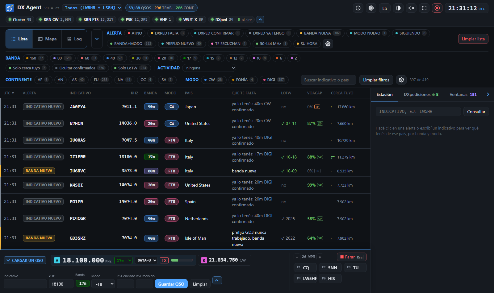
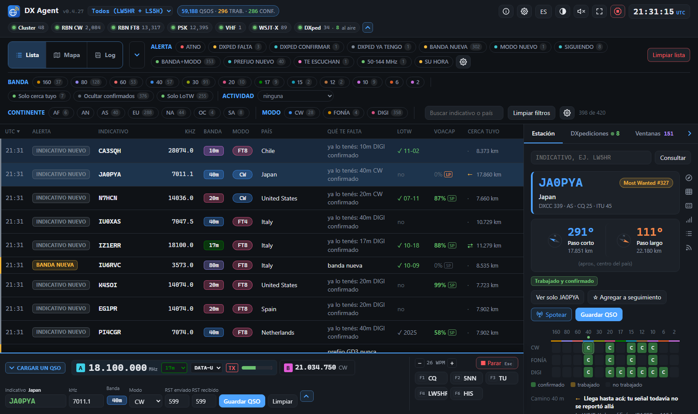
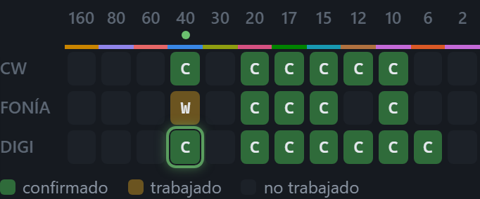
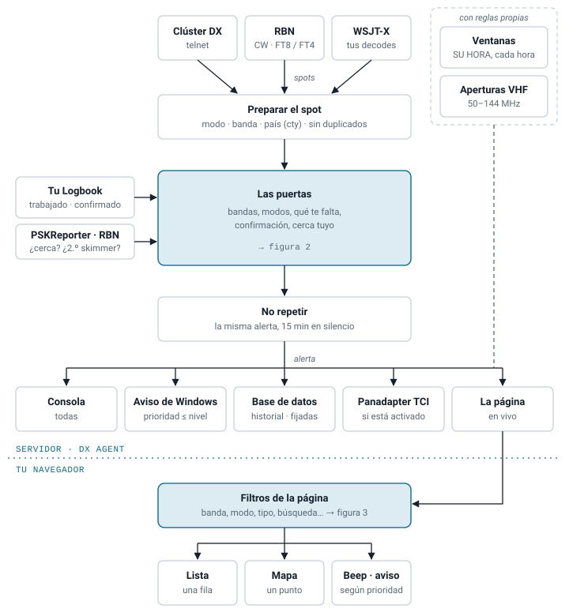
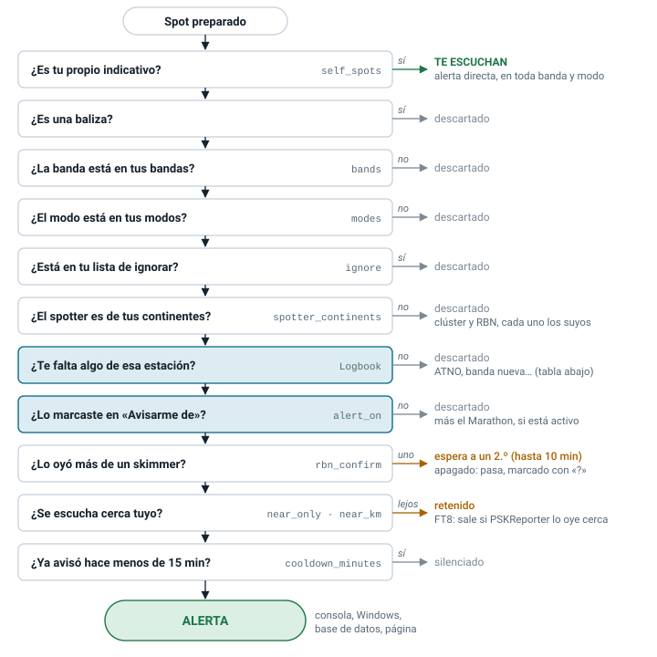
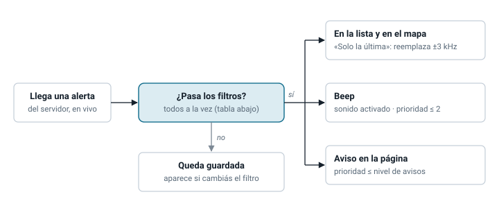
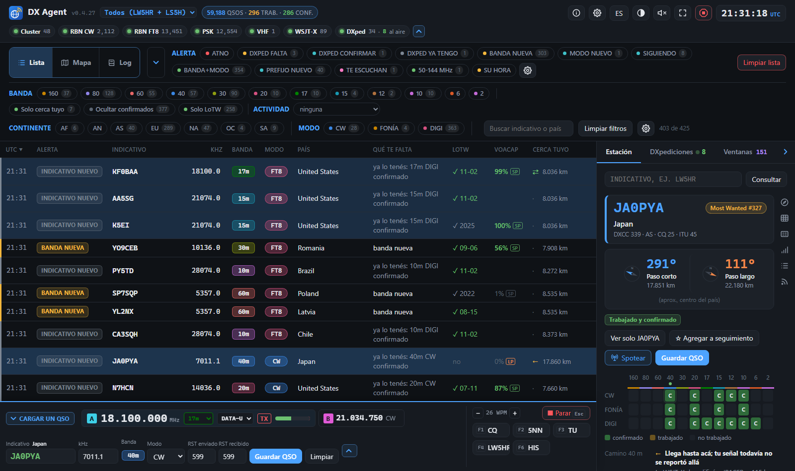
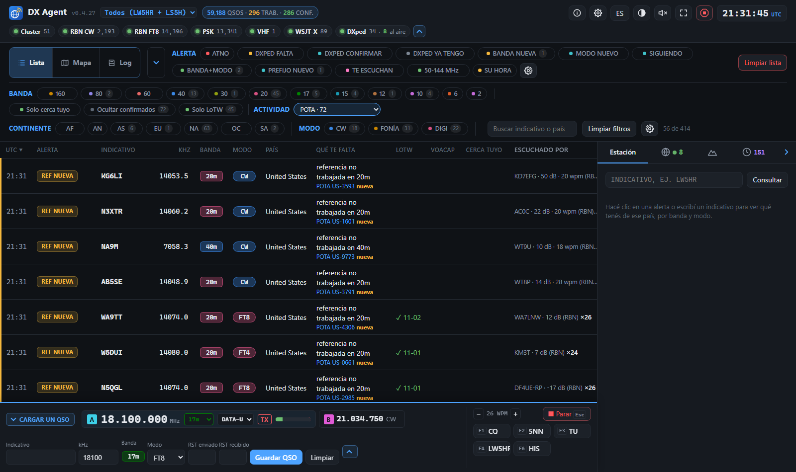
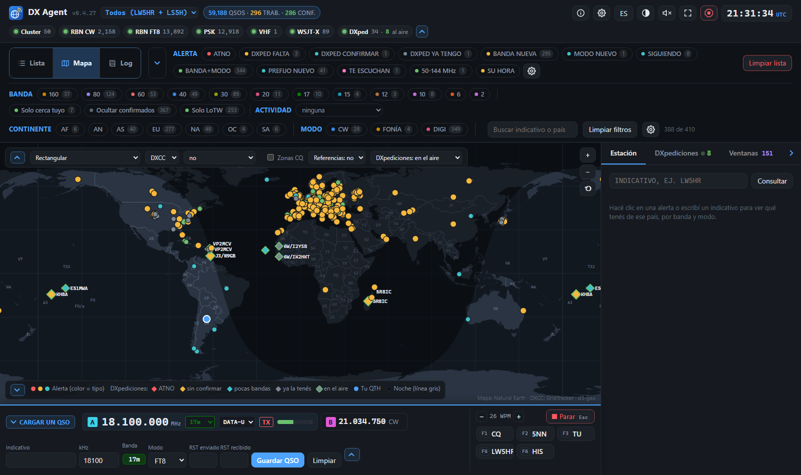

# DX Agent — Manual de usuario

*Versión 0.4.21 · Creado por Diego – LW5HR · Colaboradores: **Javi – LU5FF** (QA Product Advocate), Franco – LU2PWY, Juan Pablo – LU9HVR, Gustavo – LU7HW, Daniel – LU1HLH · [English version](MANUAL.en.md)*

DX Agent vigila el DX cluster y la Reverse Beacon Network (RBN), compara cada estación
reportada con tu log y te avisa cuando sale al aire una que todavía necesitás: un país nuevo,
una banda o un modo nuevos, una DXpedición que te suma algo, o una estación de tu lista de
seguimiento. Corre en tu PC y se maneja desde el navegador.

Contenido:

1. [Qué necesitás](#1-qué-necesitás)
2. [Instalarlo y abrirlo](#2-instalarlo-y-abrirlo)
3. [La primera configuración](#3-la-primera-configuración)
4. [La pantalla](#4-la-pantalla)
5. [Las alertas](#5-las-alertas)
6. [Sintonizar la radio y pasar el indicativo al logger](#6-sintonizar-la-radio-y-pasar-el-indicativo-al-logger)
7. [Que DX Agent vea tus QSOs al instante](#7-que-dx-agent-vea-tus-qsos-al-instante)
8. [DXpediciones](#8-dxpediciones)
9. [Activaciones: POTA, SOTA, IOTA...](#9-activaciones-pota-sota-iota)
10. [El mapa](#10-el-mapa)
11. [CQ DX Marathon](#11-cq-dx-marathon)
12. [LoTW](#12-lotw)
13. [El logbook de DX Agent (experimental)](#13-el-logbook-de-dx-agent-experimental)
14. [Actualizar a una versión nueva](#14-actualizar-a-una-versión-nueva)
15. [Problemas frecuentes](#15-problemas-frecuentes)
16. [Ayuda y contacto](#16-ayuda-y-contacto)

---

## 1. Qué necesitás

- **Windows 10 u 11, Linux (x86_64) o una Mac (Apple Silicon o Intel).** El paquete ya trae
  todo lo necesario (incluido Python): no hay que instalar nada.
- **Conexión a internet**, para recibir los spots y bajar las listas de DXpediciones,
  países y LoTW.
- **Tu log**, de una de estas dos formas:
  - un archivo **ADIF** que escriba tu programa de log: por ejemplo los backups de Log4OM,
    o una exportación ADIF de cualquier otro programa;
  - o tu cuenta de **LoTW**, si no tenés un archivo ADIF: DX Agent baja de ahí todos los QSOs
    que subiste;
  - o nada todavía, si estás empezando de cero: DX Agent te crea un log nuevo (sección 3);
  - o el **logbook de DX Agent** (experimental): DX Agent lleva tu log él mismo, lo sube a LoTW,
    Club Log y QRZ.com, y baja tus confirmaciones de LoTW y QRZ.com (sección 13).
- Opcional: tu **contraseña de LoTW**, para que DX Agent sepa qué tenés confirmado aunque tu
  programa de log no esté sincronizado.

## 2. Instalarlo y abrirlo

1. Bajá el último `dx-agent-<versión>-win64.zip` de la página
   [Releases](https://github.com/lw5hr/dx-agent-download/releases/latest).
2. Descomprimilo donde quieras, por ejemplo en `Documentos`. Tu configuración y tus datos no
   quedan ahí, sino en una carpeta tuya que usan todas las versiones (sección 14): la carpeta
   del programa se puede reemplazar o borrar.
3. Hacé doble clic en **start-dx-agent.bat**. El panel se abre en el navegador, en
   **http://localhost:8073**.

Si Windows muestra un aviso de seguridad la primera vez (el archivo viene de internet),
elegí la opción para ejecutarlo (**Ejecutar**, o **Más información → Ejecutar de todas
formas**). Para que no aparezca: antes de descomprimir, clic derecho en el zip →
**Propiedades** → marcar **Desbloquear** → Aceptar.

**Cómo corre:** sin ventana. Mientras está abierto, volver a hacer doble clic en
start-dx-agent.bat solo abre el panel otra vez (si abrís una versión más nueva, detiene la
anterior y queda ella). Para cerrarlo, botón **Detener** arriba a
la derecha del panel. Si querés ver lo que va haciendo, usá **start-dx-agent-console.bat**,
que lo abre en una ventana de consola.

Podés guardar el panel en los favoritos del navegador: `http://localhost:8073`. Solo se
puede abrir desde tu PC; otras computadoras de la red no lo ven.

### En Linux

1. Bajá el último `dx-agent-<versión>-linux-x86_64.tar.gz` de la misma página
   [Releases](https://github.com/lw5hr/dx-agent-download/releases/latest).
2. Descomprimilo en una carpeta tuya y abrilo:

   ```sh
   tar -xzf dx-agent-<versión>-linux-x86_64.tar.gz
   cd dx-agent
   ./start-dx-agent.sh
   ```

   El panel se abre en el navegador, en **http://localhost:8073**, igual que en Windows.
   `./start-dx-agent-console.sh` lo corre en la terminal, para ver lo que va haciendo.

### En una Mac

1. Bajá el último `dx-agent-<versión>-macos.tar.gz` de la misma página
   [Releases](https://github.com/lw5hr/dx-agent-download/releases/latest). Sirve para
   cualquier Mac, con Apple Silicon (M1, M2...) o Intel.
2. Hacé doble clic para descomprimirlo, y mové la carpeta `dx-agent` adonde quieras, por
   ejemplo a Documentos.
3. Hacé doble clic en **start-dx-agent.command**, adentro de esa carpeta. El panel se abre en el
   navegador, en **http://localhost:8073**, igual que en Windows.

La primera vez, macOS dice que no lo puede abrir, porque no está firmado por Apple. Abrí
**Configuración del Sistema → Privacidad y seguridad**, bajá hasta el aviso sobre
start-dx-agent.command, hacé clic en **Abrir igualmente** y confirmá; después volvé a hacer doble
clic. Desde ahí alcanza con doble clic. O, en la Terminal:

```sh
cd ~/Documents/dx-agent
xattr -dr com.apple.quarantine .
./start-dx-agent.command
```

Las notificaciones van al Centro de notificaciones de la Mac (la primera vez macOS puede pedir
permiso).

Log4OM, N1MM, DXLog.net y OmniRig son programas de Windows: leer la base de Log4OM y sintonizar
con ellos funcionan solo en Windows. Todo lo demás es igual en Linux y en la Mac (incluidos los
QSOs por UDP de WSJT-X y sintonizar con flrig, Hamlib o TCI).

## 3. La primera configuración

La primera vez el panel muestra una franja amarilla, porque todavía no sabe dónde está tu
log. Hacé clic en **Configuración** (arriba a la derecha) y completá:

1. **Estación**
   - **Indicativo:** el tuyo. Se usa para entrar al cluster y a la RBN.
   - **Tu log:** *Archivo ADIF*, *Solo LoTW* o *Empezar de cero (log nuevo)*: DX Agent crea un
     log vacío, `data\<INDICATIVO>.adi` en tu carpeta de DX Agent, y le agrega los QSOs que tus programas le mandan al
     loguearlos (WSJT-X, N1MM... ver la sección 7). Cuando empieces a usar un programa de log,
     importá ese archivo ahí y elegí Archivo ADIF. O **Logbook de DX Agent (experimental)**, para
     llevar tu log en DX Agent (sección 13).
   - **Ruta del log:** hacé clic en **Buscar…** y elegí el archivo. Si elegís un backup de
     Log4OM con fecha (`LW1ABC_20261016_124613_backup.adi`), DX Agent lo convierte en
     `…/LW1ABC_*_backup.adi`, así usa siempre el más nuevo. **Probar** muestra qué archivo
     encontró y cuántos QSOs tiene.
   - **Grid locator:** tu cuadrícula (GF05, FN31pr...). Vacío = la toma de tu log. Se usa para
     el mapa, el rumbo de antena y "cerca tuyo".
   - **Tus otros indicativos** (opcional; por ejemplo uno de concurso): **+ Agregar un
     indicativo**, el indicativo y su log: un archivo ADIF o directamente la base de datos de
     Log4OM (el archivo `.SQLite`, sin exportar nada). Las alertas, el DXCC y el WAZ suman todos
     tus indicativos juntos; el selector del encabezado permite ver uno solo.
2. **LoTW** (opcional): tu usuario y contraseña de LoTW, **Probar ingreso**. La contraseña
   queda guardada cifrada para tu usuario de Windows (en Linux y en la Mac, legible solo por vos),
   nunca en texto.
3. **Alertas:** qué tipos de alerta querés, en qué bandas y modos. Para empezar, los valores
   de fábrica andan bien.
4. **Propagación:** tu potencia, la ganancia de tu antena y el ruido donde estás, para las
   predicciones de VOACAP; y las aperturas en VHF, 6 m y 2 m (sección 5).
5. **Radio:** el programa que maneja tu radio (ver sección 6). Si no
   querés que DX Agent mueva la radio, dejalo en *Desactivado*.
6. Hacé clic en **Guardar y aplicar**. No hace falta reiniciar: en unos segundos vuelve a
   leer el log (arriba dice "Leyendo tu log…") y se conecta a las fuentes de spots.

Si algo está mal (un indicativo inválido, ninguna banda elegida...), aparece una lista en
rojo junto al botón y no se guarda nada hasta corregirlo.

La configuración está en pestañas: Estación, Log (solo con el logbook de DX Agent), LoTW,
Alertas, Propagación, Marathon, Fuentes de spots, Radio y Otros. Al guardar se respeta lo que
cambiaste a mano en `config.toml` y la página no muestra.

El panel aparece en el idioma del navegador; el botón **EN/ES/PT** del encabezado lo cambia:
inglés, español o portugués (Brasil).

## 4. La pantalla



**Encabezado:** tu indicativo (con varios, un selector: **Todos** o uno solo, para ver qué le
falta a ese); una pastilla por cada fuente de spots (verde = conectada,
ámbar = conectando, rojo = caída): Cluster, RBN CW, RBN FT8, y PSKReporter, WSJT-X, TCI y VHF
cuando los usás. **Un clic en la pastilla de una fuente** deja solo las estaciones que escuchó esa
fuente (otro clic, o **Limpiar filtros**, vuelve a mostrar todas). La pastilla **DXpediciones**
("48 · 6 en el aire": cuántas están dentro de sus fechas y cuántas se spotearon en los últimos 15
minutos; un clic abre su pestaña); la pastilla de **propagación** (**SFI · SN · A · K** de NOAA y las
tres escalas **G · R · S**, que se encienden cuando hay tormenta: en gris en 0, ámbar con 1 o 2 y roja
de 3 para arriba, y la pastilla entera se pone roja cuando la G está en 1 o más (un R o un S quedan en
su número); al pasar el
mouse, una tarjeta con los gráficos de los últimos días —el SFI de cuatro, el SN de diez, el A y el Kp
de las últimas 24 horas, cada uno en su color—, debajo el pronóstico de hoy con la chance de apagón de
radio, una tabla que dice qué es cada escala —geomagnética, apagón de radio, radiación— y cuánto marca
ahora, y otra con los umbrales ideales y críticos de SFI, K y A; la línea de arriba, con la antigüedad
de cada valor, se pone verde cuando todos los índices están en el rango bueno; un clic en la pastilla
deja la tarjeta clavada —con el borde en azul— para leerla o copiar los números, y se cierra con otro
clic, un clic afuera o Escape); los totales de tu log: los QSOs en azul, los países trabajados
en ámbar, los confirmados en verde; botones con íconos (al pasar el mouse dicen qué hace cada
uno): **Acerca de** ⓘ, **Configuración** ⚙, **EN/ES/PT**, **Tema** (un menú con una vista previa de
cada uno: Auto, Claro, Oscuro, Alto contraste oscuro y claro, Solarized oscuro y claro, Nord,
Dracula, Dracula naranja, Alucard, Alucard negro y Sepia), **Sonido** (un pitido para las alertas importantes, apagado de fábrica),
**Pantalla completa** (cuatro esquinas; también la tecla **F**, se sale con F o Esc) y
**Detener**, en rojo; el reloj UTC. **Acerca de** cuenta qué es DX Agent, quién lo hizo y sus
colaboradores, y tiene los links para apoyarlo, al sitio, a este manual y para reportar un
problema. En una ventana más angosta las pastillas pasan a una segunda línea, y la flecha que
tienen después las pliega a sus puntos de estado.

**Filtros**, arriba de la lista, en tres filas:

- botones por **tipo de alerta** (solo los tipos activados en Configuración), **banda** y **modo**
  (sin ninguno marcado se ve todo). Cada opción dice cuántas estaciones mostraría, con los demás
  filtros como están: con 20 m elegido, los modos dicen cuántas hay en 20 m;
- **Continente** (AF, AN, AS, EU, NA, OC, SA): deja las
  estaciones de los continentes elegidos, para quedarte con hacia donde apunta tu antena. Tu propio
  indicativo spoteado se ve siempre;
- **Actividad:** solo activaciones POTA, SOTA, IOTA... (sección 9);
- **Solo cerca tuyo:** solo las estaciones que escucha alguien cerca tuyo. Solo oculta las demás: siguen avisando.
  El ajuste **Avisar solo si se escucha cerca tuyo** (Configuración → Alertas) es otra cosa: con él, una estación que solo
  se escucha lejos no avisa nunca, y donde hay pocos receptores cerca la lista queda casi vacía (el panel avisa cuántas no
  avisaron). Casi siempre lo que conviene es el filtro. Lo que decodifica tu propio WSJT-X siempre cuenta como cerca
  (sección 7);
- **Ocultar confirmados:** saca lo que ya tenés confirmado en esa banda y modo;
- **Solo LoTW:** solo las estaciones que subieron a LoTW en los últimos 12 meses y las
  DXpediciones que anunciaron LoTW;
- un cuadro de **búsqueda** por indicativo o país;
- **Limpiar filtros** vuelve a mostrar todo. El navegador recuerda los filtros.
- **⚙** (junto a Limpiar filtros, o Configuración → **Filtros sobre la lista**): cuáles de Continente, Solo cerca tuyo,
  Ocultar confirmados, Solo LoTW y Actividad se ven. Uno oculto queda apagado. Los tipos de alerta, las bandas y los modos
  son los de tus alertas (Configuración → Alertas).
- **Plegar los filtros:** el chevron junto a **Lista** / **Mapa** los pliega a una línea que dice
  qué está elegido ("FILTROS 20m · CW", resaltada mientras hay un filtro), para dejarle más lugar
  a la lista; quedan la búsqueda, Limpiar filtros, la cantidad y Limpiar lista. El navegador lo
  recuerda.

**La lista de alertas:** una fila por alerta, la más nueva arriba, con el color de su tipo.
Columnas: hora UTC, tipo de alerta, indicativo, frecuencia, banda, modo, país, **qué te falta**,
LoTW, **VOACAP** (la chance de un QSO a esta hora, sección 5), **cerca tuyo** y quién la
escuchó. Las filas nuevas destellan. Cuando la estación vuelve a
aparecer en la misma banda y modo, su fila se actualiza (hora, frecuencia, quién la escuchó, ×N):
muestra dónde está ahora. Las filas se atenúan a los 10 y a los 30 minutos del último spot de la
estación ahí.

**Limpiar lista** (en rojo, arriba a la derecha): vacía la lista, después de preguntar. Lo que
siga en el aire vuelve a avisar en su próximo spot. **Una sola estación:** la **✕** al lado de su
indicativo (aparece con el mouse sobre la fila), o clic derecho en la fila → **Quitar de la
lista**.

**Fijar una estación:** el **ancla** al lado de la ✕ la deja en la lista en esa banda aunque haga
mucho que no se spotea: no la saca **Quitar de la lista después de**, ni Limpiar lista, ni
reiniciar DX Agent. Va arriba de todo con cualquier orden, con su ancla siempre a la vista (en el
color del skin), y también queda en el panadaptador de la radio. Sale cuando la trabajás en esa
banda, con su ✕, o con otro clic en su ancla.

**Ordenar por una columna:** al hacer clic en el encabezado de una columna la lista se ordena por
ella: por frecuencia, por banda, por modo (CW, fonía y digitales juntos), por país... **Alerta** y
**Qué te falta** ponen primero lo más buscado, **LoTW** las subidas más recientes. Otro clic lo
invierte, y un tercero vuelve a lo más nuevo arriba. Una flecha muestra el orden. Las alertas
nuevas entran en su lugar, y el navegador recuerda el orden.

**A la derecha, la pestaña Estación:** al hacer clic en una fila (en el indicativo o en la
frecuencia) se abre la estación:

- una tarjeta con el indicativo, el país, sus zonas y su puesto en el **Most Wanted** de Club Log;
- los dos **rumbos de antena**, grandes, cada uno con su brújula y su distancia: el paso corto en
  azul y el paso largo en naranja;
- la grilla banda × modo de ese país: **C** verde = confirmado, **W** ámbar = trabajado, gris =
  falta. **Al pasar el mouse sobre una C o una W** ves los QSOs que la hicieron (indicativo,
  fecha, modo, ✓ si está confirmado): sabés enseguida si ese QSO de 20 m fue esta DXpedición u
  otra estación de hace años;
- **dónde está en el aire ahora**, en esa misma grilla: un **anillo verde** en cada banda y modo
  donde la spotearon en los últimos 15 minutos, y un punto ● sobre la banda. El cuadro del
  **spot más reciente parpadea**: ahí está ahora la estación; los otros quedan con el anillo
  fijo, y el parpadeo se mueve cuando la spotean en otra banda. Una DXpedición en varias bandas
  a la vez (por ejemplo S9R) muestra un anillo en cada una, y parpadea la más reciente. Pasando
  el mouse por un cuadro con anillo ves cuándo, dónde y quién la spoteó; **con un clic sintonizás
  ahí** (con una radio configurada, sección 6). Sin spots durante 15
  minutos, el anillo se apaga. Un anillo sobre un cuadro vacío: está en el aire en una banda que
  te falta;
- si ya trabajaste ese indicativo exacto, su estado de LoTW y, si es una DXpedición, sus datos;
- si la estación dijo su grid locator en el aire (tu WSJT-X, FT8/FT4 de la RBN), su **grid** y cómo
  lo tenés en la banda en que la spotearon: "Grid DN39 · 20 m: GRID NUEVO", o confirmado, y en qué
  otras bandas lo trabajaste. La grilla banda × modo de arriba es la del país; esta fila es la del
  grid;
- **el camino**: si tu señal llega a la zona de la estación y la de ella a la tuya, con lo
  medido en los últimos 15 minutos (sección 5);
- **Propagación (VOACAP)**: las próximas 24 horas por banda, para CW, SSB, FT8, FT4 o RTTY, con
  la hora actual marcada; pasando el mouse por un cuadro se ven sus números (sección 5);
- con el CQ DX Marathon activado, qué te suma en el Marathon (sección 11);
- para una estación en un **parque POTA o una cumbre SOTA**, una tarjeta con lo que dicen pota.app
  o SOTA: nombre, tipo y lugar, cuántas activaciones y QSOs, quién la activó primero, sus últimas
  activaciones, si **vos** la trabajaste y en qué bandas (o "Nueva para vos"), y enlaces;
- **Quién lo escucha**, los receptores más cercanos a vos primero, y el botón **Consultar
  PSKReporter** para FT8/FT4 (o, con PSKReporter en vivo, los receptores a medida que la
  reportan: sección 5). Su resumen es de la banda del camino de la estación: escucharla en 20 m
  (también con tu propio WSJT-X) no dice nada de 17 m, así que dice «En 17m nadie la reportó en
  los últimos 15 minutos. Sí se escucha cerca tuyo en 20m.». La lista de abajo sigue con los
  reportes de todas las bandas, cada uno con la suya;
- **Ver solo** este indicativo, **☆ seguimiento** para sumarlo a tu lista de seguimiento,
  **Spotear** (ver abajo), sus **Últimos spots** y enlaces a QRZ.com, HamQTH y DXWatch.
  **Últimos spots** y **Quién lo escucha** son pastillas: al pasar el mouse dicen qué lista cada
  una;
- una tira de **íconos a su derecha**, uno por sección: un clic oculta esa sección para todas las
  estaciones, otro la vuelve a mostrar. El navegador recuerda cuáles.

Las referencias WWFF, IOTA y COTA también tienen su tarjeta, como POTA y SOTA.

**Spotear** (el botón de la antena) publica un spot de la estación en el DX cluster al que está
conectado DX Agent, con tu indicativo: por ejemplo `DX 14025.0 3Y0K up 2`. Abre un formulario
chico con la frecuencia de la fila en la que hiciste clic (la podés cambiar) y un comentario
(hasta 30 caracteres, sin acentos), y pide confirmación. Después te dice si el cluster lo tomó:
**publicado** cuando te lo devuelve, **enviado** cuando no lo devuelve (W3LPL, por ejemplo), o lo
que respondió si lo rechazó. Como máximo un spot cada 30 segundos; con el cluster apagado o caído
el botón queda gris.





**La pestaña DXpediciones:** ver la sección 8. **La pestaña Marathon:** ver la sección 11.
Con un clic en un país del mapa, la pestaña Estación muestra ese país (sección 10).

**Plegar el panel:** el chevron a la derecha de las pestañas pliega el panel de la derecha a una
tira con sus íconos, donde siguen las DXpediciones en el aire y el puntaje del Marathon; un clic
en un ícono lo abre en esa pestaña. Mientras está plegado, al pasar el mouse por una fila de la
lista aparece la ficha de esa estación: su país, su estado y su grilla banda × modo. El
navegador lo recuerda.

**Lista / Mapa / Log:** a la izquierda de los filtros, cambia entre la lista, el mapa (sección 10)
y, con el logbook de DX Agent, tu log (sección 13). Con el logbook, debajo de las tres va la
**consola** para cargar QSOs, con tu radio y el WinKey (sección 13).

## 5. Las alertas

| En el panel | Qué quiere decir | De fábrica |
|-------------|------------------|------------|
| **ATNO** | País que nunca trabajaste | activada, con notificación de Windows |
| **DXPED FALTA** | DXpedición activa que te suma un país, una banda o un modo | activada |
| **DXPED CONFIRMAR** | DXpedición de un país trabajado pero no confirmado en esa banda o modo | activada |
| **DXPED YA TENGO** | DXpedición que ya tenés confirmada en esa banda y modo (gris) | activada |
| **BANDA NUEVA** | País trabajado, pero no en esta banda | activada |
| **MODO NUEVO** | País trabajado, pero no en este modo (CW, fonía, digital) | activada |
| **SIGUIENDO** | Un indicativo de tu lista de seguimiento | activada |
| **BANDA+MODO** | País no trabajado en esta combinación de banda y modo | desactivada |
| **GRID NUEVO** | Un grid que no trabajaste en esta banda, en cualquier modo (VUCC, FFMA). Solo avisan los spots que dicen el locator: los decodes de tu WSJT-X y FT8/FT4 de la RBN (sección 10) | desactivada |
| **PREFIJO NUEVO** | Un prefijo que nunca trabajaste, en ninguna banda ni modo, como los cuenta el diploma CQ WPX (LU1ABC: LU1; N8BJQ/KH9: KH9). Muchas menos que INDICATIVO NUEVO | desactivada |
| **INDICATIVO NUEVO** | Este indicativo exacto no está en tu log (genera muchísimas alertas) | desactivada |
| **MARATHON** | Un país o una zona CQ que todavía no trabajaste en el CQ DX Marathon (sección 11) | activada, si seguís el Marathon |
| **TE ESCUCHAN** | Spotearon tu propio indicativo, en cualquier banda y modo, en el cluster, la RBN o, con PSKReporter en vivo, un receptor de PSKReporter: la fila va resaltada en rosa y dice a qué distancia y en qué país está el receptor ("te escuchan a 8.912 km, en United States"). Al hacer clic se ven todos los receptores que te escucharon, también en el mapa | activada |
| **50 MHz**, **144 MHz** | 6 m o 2 m abiertos a tu alrededor (ver Aperturas en VHF, más abajo); resaltada en verde | desactivada |
| **SU HORA** | Al empezar cada hora UTC, un país que te falta y que suele escucharse cerca tuyo a esa hora (ver Ventanas, más abajo) | activada |

- **Avisos arriba a la derecha:** las alertas de tu nivel de notificación (Configuración →
  Notificaciones de Windows; de fábrica, solo ATNO), toda apertura en VHF, un ducto en 2 m y una
  DXpedición que sale al aire aparecen también arriba a la derecha del panel, uno debajo del otro.
  Cada uno queda 2 minutos (no mientras tenés el mouse encima), con su ✕ y **Cerrar todos**; un clic
  te lleva a la fila de la alerta, con el panel de su estación abierto.
- **Qué te falta** dice exactamente qué te suma la estación: "banda nueva", "17m DIGI nunca
  trabajado", "grid EN52 nunca trabajado en 6m", "país no confirmado", o "ya lo tenés".
- **Confirmado** es LoTW o QSL en papel, como en el DXCC de la ARRL (eQSL no cuenta). Solo
  cuentan las entidades vigentes: una borrada que traen QSOs viejos (85 Antillas Neerlandesas,
  como la informa LoTW) no entra en ningún total, tampoco en los trabajados y confirmados del
  encabezado.
- **LoTW** dice si la estación sube a LoTW (y cuándo subió por última vez), si la DXpedición
  anunció LoTW, o "no LoTW".
- **Cerca tuyo:** **● 732 km · 7 dB** en verde = la escuchó un receptor dentro de tu radio
  "cerca" (1.500 km de fábrica); en gris, la distancia al receptor más cercano; **—** = nadie
  la reportó en los últimos 15 minutos. Antes de la distancia, **el camino**, con lo medido en
  los últimos 15 minutos en esa banda: **⇄** (verde) en los dos sentidos, **→** (verde) tu señal se
  reportó cerca de la estación, **←** (ámbar) la estación llega hasta acá pero tu señal todavía no
  se reportó allá, un **·** tenue nada medido todavía. Es una medición, no una predicción: cuanto
  más transmitís (unos CQ en FT8), más sabe. La pestaña Estación lo dice en palabras.
- La misma alerta no se repite durante 15 minutos (se cambia en Configuración), ni siquiera al
  guardar la Configuración o volver a abrir DX Agent: la estación vuelve a la lista cuando la
  spotean, pero no muestra otra notificación ni vuelve a sonar.
- **Alertas de la RBN: esperar a un 2.º skimmer** (Configuración → Alertas, activado de fábrica):
  una estación que escuchó un solo skimmer de la RBN avisa cuando la escucha otro skimmer, o
  alguien en el cluster o en PSKReporter (unos minutos como mucho), así un indicativo mal
  decodificado por un skimmer (P9DX como ATNO) no avisa. Los spots del cluster, que publican
  personas, y las DXpediciones activas avisan enseguida. Desmarcado: avisan todos enseguida,
  marcados con **?**.
- **Un tipo de alerta que apagás en Configuración también sale de la lista:** una alerta solo de
  ese tipo se va, y una que tiene otro motivo pasa a mostrarlo (BANDA NUEVA en vez de INDICATIVO
  NUEVO).
- Una alerta puede ser de varios tipos a la vez: una BANDA NUEVA que además es un grid nuevo
  aparece con el filtro **GRID NUEVO**, y con ese filtro elegido la fila dice GRID NUEVO.
- En Configuración → Alertas también están **Dejar solo la última fila de cada estación** (mismo
  indicativo, banda y modo, a 3 kHz o menos) y **Quitar de la lista después de** N minutos sin spot (0 =
  nunca): las dos apagadas de fábrica. Una estación que salió de la lista vuelve apenas la spotean de
  nuevo, aunque todavía no vuelva a avisar.
- La lista guarda las últimas 500 alertas. Cuando se llena, se van primero las de INDICATIVO
  NUEVO; las demás quedan al menos una hora.
- Cuando trabajás la estación, sus alertas en la lista cambian solas: una BANDA+MODO que ya
  trabajaste deja de serlo (y de aparecer con ese filtro), y una alerta que ya no te suma nada queda
  como **TRABAJADO**, en gris. Una DXpedición también: trabajada en esa banda y modo queda como
  TRABAJADO; en otra banda o modo sigue avisando.
- Las **notificaciones de Windows** salen de fábrica solo para ATNO; en Configuración se
  pueden activar para más tipos. Al hacer clic en una se abre el panel en esa estación.

**Lista de seguimiento:** indicativos que querés que te avisen siempre que salgan, aunque no
te sumen nada. Admite comodines, por ejemplo `VP8*`. Se edita en Configuración o con la ☆ de
la pestaña Estación. **Ignorar** hace lo contrario: esos indicativos nunca alertan. En los
filtros, **SIGUIENDO** junto con otro tipo muestra solo los que seguís que además son de ese
tipo: **SIGUIENDO** + **BANDA+MODO** son tus indicativos en seguimiento en una banda y modo que
te faltan.

**PSKReporter en vivo:** en Configuración → Fuentes de spots → **PSKReporter** podés elegir
**Cuando lo pedís** (una consulta cada 5 minutos, con el botón de la pestaña Estación; es lo de
fábrica) o **En vivo (MQTT)**: los reportes de PSKReporter a medida que llegan, sin límite, para la
estación abierta en la pestaña Estación y las alertas digitales de la lista. Sus receptores
cuentan para "cerca tuyo" y el mapa sin apretar ningún botón, y una pastilla **PSKReporter** en el
encabezado muestra la conexión. Necesita tu grid locator. Con **Avisar solo si se escucha cerca
tuyo**, una estación digital que no avisó por escucharse solo lejos avisa apenas un receptor de
PSKReporter cerca tuyo la reporta en esa banda. También se siguen tus propios indicativos: cada
receptor que te reporta es una fila **TE ESCUCHAN**, con su SNR y su distancia.

### Cómo decide DX Agent si avisa

Un spot pasa por dos etapas de filtros. Las de DX Agent deciden si **es** una alerta: si no las
pasa, no hay fila, ni notificación, ni sonido. Las del panel solo deciden qué alertas **ves** en la
lista y en el mapa: lo que ocultan sigue guardado y aparece apenas cambiás el filtro. Por eso la
notificación de Windows no depende de los filtros del panel. El sonido y el aviso de arriba a la
derecha, en cambio, sí.



*Figura 1: del spot a la pantalla.* Ventanas (SU HORA) y las aperturas en VHF no pasan por las
puertas: cada una tiene sus propios ajustes (más abajo). PSKReporter no genera alertas por sí solo.
Sirve para saber si una estación se escucha cerca tuyo y para confirmar lo que oyó un solo skimmer.

**Las puertas.** Cada spot pasa estas preguntas, en este orden. En la primera que no pasa, no hay
alerta. La única que se saltea las demás es tu propio indicativo.



*Figura 2: las puertas.* En gris, el spot se descarta. En ámbar, espera a que otro receptor lo
confirme:

- **Lo oyó un solo skimmer** (con **Alertas de la RBN: esperar a un 2.º skimmer** activado): avisa
  cuando lo oye otro skimmer, o alguien en el cluster o en PSKReporter, dentro de los 10 minutos.
  Una DXpedición activa no espera. Desactivado, avisa enseguida, marcado con **?**.
- **Se escucha solo lejos** (con **Avisar solo si se escucha cerca tuyo**): avisa con el próximo
  spot de alguien cerca tuyo. En digital, con PSKReporter en vivo, avisa apenas un receptor cerca
  tuyo la reporta.

Una DXpedición que ya tenés confirmada en esa banda y modo solo avisa (DXPED YA TENGO, en gris) con
**DXpediciones que ya tenés: Mostrarlas igual**. Al lado de cada puerta está su clave en
`config.toml`; la tabla del final dice dónde se cambia en Configuración.

**La misma alerta.** Durante **No repetir durante** (15 minutos de fábrica), una alerta no se
repite. Qué cuenta como «la misma» depende de por qué avisó:

| Avisó por | Es la misma si coincide |
|-----------|-------------------------|
| ATNO, BANDA NUEVA, MODO NUEVO, BANDA+MODO | El país, la banda y el modo: con una estación de EE. UU. en 20 m CW alcanza, la segunda no suena |
| DXPED, SIGUIENDO, INDICATIVO NUEVO, TE ESCUCHAN, SU HORA | El indicativo, la banda y el modo |
| GRID NUEVO, PREFIJO NUEVO | El grid o el prefijo, y la banda |
| MARATHON | El país o la zona CQ, la banda y el modo |

Si avisó por varios motivos a la vez, se calla solo cuando todos están dentro de ese tiempo.
**Limpiar lista** también olvida lo avisado: lo que siga en el aire vuelve a avisar en su próximo
spot.

**Los filtros del panel.** Una alerta que llega al panel se muestra si pasa todos los filtros
elegidos a la vez:



*Figura 3: los filtros del panel.* Una alerta de antes de volver a abrir DX Agent entra en la
lista, pero sin sonido ni aviso. El mapa usa los mismos filtros que la lista: un punto por
estación.

| Filtro | Qué deja ver |
|--------|--------------|
| **Banda**, **Modo** | Esas bandas y esos modos (CW, fonía, digital) |
| **Tipo de alerta** (ATNO, BANDA NUEVA…) | Esos tipos. Solo aparecen los que marcaste en **Avisarme de**. SIGUIENDO junto con otro tipo: los que seguís que además son de ese tipo |
| **50-144 MHz** | Las aperturas en VHF, y sus caminos en el mapa |
| **Búsqueda** | Un indicativo o un país, también por su nombre en castellano: «Estados Unidos», «Japon», con o sin acento |
| **Solo** *indicativo* | Una sola estación; TF/X y X/TF cuentan como la misma |
| **Continente** | Las estaciones de ese continente |
| **Actividad** | Las activaciones: POTA, SOTA, WWFF, IOTA… |
| **Ocultar confirmados** | Lo que todavía no tenés confirmado en esa banda y modo |
| **Solo cerca tuyo** | Lo que escuchó un receptor dentro de tu distancia «cerca tuyo» |
| **Solo LoTW** | Las estaciones que subieron a LoTW en los últimos 12 meses, y las DXpediciones que lo anunciaron |
| Una **pastilla** del encabezado (cluster, RBN, PSKReporter, WSJT-X, VHF) | Solo lo que escuchó esa fuente. Con **VHF**, solo las aperturas, con sus caminos en el mapa |

TE ESCUCHAN y las aperturas no se filtran por continente, confirmados, cerca tuyo ni LoTW, porque
son sobre vos, no sobre una estación. TE ESCUCHAN pasa además cualquier pastilla. Las alertas
fijadas van siempre arriba. **Dejar solo la última fila de cada estación** y **Quitar de la lista
después de** (Configuración → Alertas) cambian solo la lista.

**Dónde se cambia cada cosa:**

| En Configuración | En `config.toml` | Qué cambia |
|------------------|------------------|------------|
| **Avisarme de** | `[alerts] alert_on` | Qué motivos son alerta |
| **Bandas**, **Modos** | `[alerts] bands`, `modes` | Las puertas de banda y modo |
| **Lista de seguimiento**, **Ignorar** | `[alerts] watchlist`, `ignore` | Indicativos que siempre o nunca avisan (admiten `*`) |
| **Spotters del cluster de**, **Solo skimmers en** | `[cluster] spotter_continents`, `[rbn] spotter_continents` | La puerta del spotter, por separado para el cluster y la RBN |
| **Alertas de la RBN: esperar a un 2.º skimmer** | `[alerts] rbn_confirm` | La puerta del 2.º skimmer |
| **Avisar solo si se escucha cerca tuyo**, **«Cerca tuyo» significa a menos de** | `[alerts] near_only`, `near_km` | La puerta de cerca tuyo, y la distancia del filtro **Solo cerca tuyo** |
| **No repetir durante** | `[alerts] cooldown_minutes` | La última puerta |
| **Notificaciones de Windows** | `[alerts] desktop`, `notify_max_priority` | Si sale la notificación, y para qué alertas (también el aviso de arriba a la derecha) |
| **Tu propio indicativo** | `[alerts] self_spots` | TE ESCUCHAN |
| **Ventanas**, **CQ DX Marathon**, **Aperturas en VHF** | `[windows]`, `[marathon]`, `[vhf]` | Sus propias alertas: SU HORA, MARATHON, 50 MHz y 144 MHz |

### La predicción: VOACAP

El camino dice lo medido; **VOACAP** dice qué esperar: la ionosfera mediana del mes a esa hora,
entre vos y la estación, en los dos sentidos (tu señal allá y la de ellos acá). Viene incluido
(DVOACAP de VE3NEA, en Python: no hay nada que instalar). Necesita tu grid locator. En **Configuración → Propagación** poné tu
potencia, la ganancia de tu antena (unos 3 dBi un dipolo o una vertical, 8 a 10 una Yagi) y el
ruido donde estás (residencial, rural o silencioso).

- La columna **VOACAP** de la lista: la chance de un QSO en la banda y el modo de la fila a esta
  hora, verde desde 50%, ámbar desde 10%; pasando el mouse, la SNR de cada sentido y la MUF. Para
  FT8 y FT4 también da la SNR como la informa WSJT-X, para comparar con los reportes que recibís.
  VOACAP llega hasta 30 MHz: nada en 6 m para arriba.
- **Propagación (VOACAP)** en la pestaña Estación: las próximas 24 horas por banda, con la hora
  actual marcada, para CW, SSB, FT8, FT4 o RTTY.
- **Paso corto o paso largo:** calcula los dos caminos, el directo y el que da la vuelta al mundo
  por el otro lado, y muestra el más conveniente: al lado del porcentaje, la lista dice **SP** (paso
  corto) o **LP** (paso largo, resaltado). Por paso largo, la pestaña Estación raya esa hora, y pasando el mouse ves la distancia y hacia dónde apuntar la
  antena (desde Sudamérica, Japón en 15 m al atardecer, por ejemplo). En el **Rumbo** de la pestaña
  Estación, el camino mejor ahora va resaltado y el otro más tenue. Por paso largo la predicción es
  más aproximada.

**De dónde sale: el número de manchas solares.** VOACAP no inventa la ionósfera: la toma de unos
mapas del mes hechos para un número de manchas solares, y ese número es lo que la mueve. Con más
manchas el foF2 y la MUF suben y las bandas altas dan mejor chance; con menos, al revés, y las bajas
aguantan mejor. Por eso DX Agent usa el de hoy y no el del mes:

- **El efectivo de KC2G** ([prop.kc2g.com](https://prop.kc2g.com/), de Andrew Rodland, KC2G, con las
  ionosondas de GIRO): el que mejor se ajusta a lo que miden hoy las ionosondas del mundo, pedido una
  vez por hora. Después de una tormenta la predicción baja con las bandas.
- **El de NOAA, de respaldo:** si KC2G lleva 6 horas sin dar un valor, o con **Configuración →
  Propagación → Número de manchas solares** desmarcado, es el que NOAA predice para el mes.

**Las ionosondas: la ionósfera de hoy.** Con **Configuración → Propagación → Ionosondas** prendido
(es lo de fábrica), cada 15 minutos DX Agent lee las ionosondas que publica KC2G (GIRO, INGV, el BoM
de Australia y otras) y las usa adentro de la predicción, para todas las que hace: la columna VOACAP
de la lista, las 24 horas de la pestaña Estación, la pestaña Ventanas y el F2 de 6 m.

- **Un número de manchas solares por zona**, el que hace que los mapas den el foF2 y la MUF que
  miden las estaciones alrededor de ese camino.
- **Una corrección del foF2** en el primer salto (cerca tuyo) y en el último (cerca de la estación).
  Cuenta más de este a oeste que de norte a sur y nunca cruza la anomalía ecuatorial.
- Una medición pesa menos con el tiempo: a la hora y media vale la mitad, y pasadas seis horas no se
  usa. La corrección **se apaga hacia adelante**: a las tres horas queda la mitad.
- **Sin ionosondas cerca de un camino**, la predicción es la de antes: los mapas con el número
  efectivo de KC2G, o el de NOAA si tampoco hay.
- **Cada predicción dice de dónde sale**, en el tooltip de la lista y en la pestaña Estación:
  «VOACAP + Tucumán, hace 12 min» o «manchas solares 92 (KC2G eSSN)», con el crédito de cada
  estación; también una corrección grande («foF2 un 30 % bajo la mediana cerca de Tucumán»).
- En 6 m, una ionosonda a menos de 500 km tuyo que mide un foEs alto avisa que 6 m puede abrir por
  Es.
- Se apaga en **Configuración → Propagación → Ionosondas**.

**VOACAP contra el aire dice cuánto acierta.** En la pestaña Estación, al lado de la predicción, lo
que pasó en la última hora («VOACAP decía 20 m al 15 % hacia JA; la escucharon 6 receptores cerca
tuyo»). Cuenta sólo el camino entre vos y la estación: los receptores cerca tuyo que la
escucharon, o —si sólo se escuchó lejos— los que estaban reportando en esa misma banda. Con pocos,
no se concluye nada: una banda callada no es una banda cerrada.

Debajo del cuadro de 24 horas, la tabla de los últimos 30 días, por banda: **acierta** (la daba
abierta y se escuchó cerca tuyo, o cerrada y no llegó), **corto** (la daba cerrada y se escuchó
cerca tuyo: conviene probar aunque la dé cerrada), **optimista** (la daba abierta y sólo se escuchó
lejos, con suficientes receptores tuyos en ella: no te fíes cuando la da abierta) y **horas** (los
casos que hay detrás: con pocos, el porcentaje vale poco). Debajo, **Por hora UTC**, más verde
cuanto más acertó a esa hora. Al pasar el mouse por una columna, por la tira o por el «?» del
título, está todo esto explicado. La tabla es la suma de todas las zonas de la lista, no de la
estación elegida, y compara la predicción que muestra la app, con las ionosondas adentro.

Sigue siendo una predicción: un día dado la banda puede estar mejor o peor; el camino, cuando hay
algo medido, dice lo que pasa ahora.

### Aperturas en VHF: 6 m y 2 m

**Configuración → Propagación → Aperturas en VHF** vigila los reportes en vivo de PSKReporter y pone
una alerta **50 MHz** o **144 MHz** en la lista cuando la banda se abre a tu alrededor. Necesita tu
grid locator. De dos formas, cada una se activa por separado:

- **Estaciones cerca tuyo que escuchan lejos:** varias estaciones cerca tuyo escuchan varias
  estaciones de un mismo lugar (un país, un continente o un field). Sirve donde hay estaciones
  activas cerca.
- **Estaciones que te escuchan:** varias estaciones lejanas de un mismo lugar te reportan. Solo
  mientras transmitís (FT8, FT4, CW...); sirve donde no hay nadie más en el aire.

Qué te falta lo dice ("abierta a Japón: 3 cerca tuyo escuchan 2"). Una apertura avisa una vez; su
fila la sigue y dice "cerrada" cuando dejan de llegar reportes. La pastilla **VHF** cuenta las
aperturas abiertas ahora. Todos los números (cuántas estaciones, a qué distancia, por cuánto
tiempo) se pueden configurar.

- **Qué es probablemente:** cada fila empieza con su tipo: Es, Es multisalto, F2, TEP (de la noche
  o de la tarde), tropo, aurora o meteor scatter, según la banda, la distancia, si el camino cruza
  el ecuador geomagnético, el Kp y las manchas solares del mes. Es solo una etiqueta: no decide si
  avisa.
- **Clima espacial:** la pastilla **VHF** muestra el Kp, el índice A y el flujo solar de NOAA, con
  el Kp en rojo durante una tormenta (Kp 5 o más). **☄ MS** parpadea en los dos días alrededor del
  pico de una de las diez lluvias de meteoros principales.
- **Una fila sale de la lista** 45 minutos después de su último reporte (una de tropo, 60), y
  mientras tanto se va apagando; una anclada se queda.
- **En el mapa**, con el filtro **50-144 MHz** o la pastilla **VHF** activados: los últimos caminos
  de cada apertura en su color, los puntos donde rebota la Es agrupados en nubes, y la tropo como un
  pasillo ancho. Sin ninguno de los dos no se dibujan, para no tapar el mapa del DX.
- **Tropo en 2 m por el pronóstico** (se activa aparte): una vez por hora, el pronóstico de
  Open-Meteo para tu QTH y 24 puntos alrededor dice dónde hay un ducto antes de que se escuche la
  banda. Un ducto sobre vos, o en dos puntos de un mismo rumbo, avisa una vez (notificación de
  Windows, sonido y aviso en el panel) y la pastilla muestra **≋ TROPO**; en un solo punto es
  posible, **≋ TROPO?** en amarillo, sin sonido. Uno pegado al suelo y fino (sobre el mar a la
  tarde) no sirve para 2 m: se muestra y no avisa. Con la pastilla **VHF** activa, el mapa muestra
  los puntos y una línea desde tu QTH hasta cada ducto ("NE 400 km").

### Ventanas: cuándo se escucha cada país que te falta

La pestaña **Ventanas** cuenta, por hora UTC, banda y modo, en cuántos días se escuchó cerca tuyo
cada país que todavía te falta: los spots del cluster, la RBN, PSKReporter y tu WSJT-X escuchados
dentro de tu distancia "cerca tuyo".

- **Una fila por país,** con sus 24 horas como una línea de barras y su puesto en el **Most Wanted**
  de Club Log. **Orden:** A–Z, Most Wanted o Esta hora. Un país con un spot en los últimos 15 minutos
  va en verde.
- **Un clic en un país** muestra cada banda y modo hora por hora: lleno donde se escuchó, tenue
  donde VOACAP lo predice.
- **La alerta SU HORA:** al empezar cada hora UTC, el país que te falta que más se escucha a esa
  hora, si se escuchó en 2 días o más (y en los últimos 45). Hacen falta unos días de conteo; hasta
  entonces, filtrar por SU HORA dice por qué la lista está vacía. Se configura en Configuración →
  Ventanas.

## 6. Sintonizar la radio y pasar el indicativo al logger

Con una radio configurada (Configuración → **Radio (botón Sintonizar)**), al hacer clic en
la **frecuencia** de una alerta tu programa mueve la radio ahí y la estación se abre a la
derecha. En la consola, después de las radios (sección 13), aparece también un botón
**Sintonizar**: al lado de ellas si entra, y un botón por slice o por radio en una línea propia
debajo (la consola crece en alto, nunca a lo ancho). Con el logbook de DX Agent apagado no hay
consola, y el botón está en la pestaña Estación. Un mensaje arriba a la
derecha dice si funcionó.

| Programa | Qué hay que hacer en el programa | ¿Cambia el modo? |
|----------|----------------------------------|------------------|
| **Log4OM 2** | Settings → Software integration → Connections → activar **Remote control** (puerto 2241) | sí, si Log4OM usa OmniRig |
| **N1MM Logger+** | Config → Configure Ports… → **Broadcast Data**: marcar **Radio** y agregar `127.0.0.1:12065` (el puerto UDP de DX Agent) | no |
| **DXLog.net** | Options → Broadcast: **Radio** al puerto UDP de DX Agent, con **Use N1MM QSO format** | no |
| **OmniRig** | elegir en DX Agent la radio 1 o 2 de OmniRig | sí |
| **Hamlib (rigctld)**, la opción para empezar | que rigctld esté corriendo, o que lo arranque DX Agent (abajo) | sí |
| **flrig** | su servidor XML-RPC (puerto 12345); para sintonizar, **Sintonizar por flrig** en DX Agent (ver abajo) | sí |
| **DXLab Commander** | no sintoniza (ver abajo) | — |
| **TCI** (AetherSDR para FlexRadio, ExpertSDR, Thetis) | AetherSDR: Settings → **Autostart TCI with AetherSDR** (o **Enable** en su applet TCI, puerto 50001) | sí |

- **Hamlib, la opción para empezar.** Sintoniza, cambia el modo y el split, y lee la radio para la
  consola de abajo de la lista: frecuencia, modo, TX, split y S-meter. Si rigctld se desfasa de la
  radio (una frecuencia imposible, lectura tras lectura), DX Agent se queda con la última lectura
  buena y vuelve a arrancar rigctld solo.
  - **Su `rigctld` tiene que estar corriendo.** Marcá **Iniciar rigctld con DX Agent** y escribí sus
    argumentos: el modelo de tu radio, su puerto COM y su velocidad, por ejemplo
    `-m 3068 -r COM7 -s 19200` para un IC-9100 (`rigctl -l` lista los modelos). DX Agent arranca
    rigctld junto con él y lo cierra cuando se detiene, y le agrega `-C cache_timeout=0` para leer
    el PTT de la radio (si arrancás rigctld vos, agregalo a sus argumentos).
  - **Un puerto COM lo abre un programa por vez**, así que esa radio no puede estar también en
    OmniRig.
- **Dos radios.** Configuración → Radio tiene una **Radio 2** debajo de la Radio 1, con su propio
  programa, dirección y nombre.
  - **Solo una de las dos puede ir por TCI.** Dos por Hamlib necesitan un rigctld cada una, en su
    propio puerto.
  - **La radio activa** es la última que sintonizaste o con la que transmitiste, o la que elegís con
    un clic en la consola (sección 13). Las frecuencias de la lista de alertas la sintonizan, y
    Sintonizar, en la consola, tiene un botón para cada radio.
  - **Las dos en N1MM o DXLog.net (SO2R):** cada radio recibe su propio número de radio.

- **Nunca mientras transmitís.** Antes de cada cambio de frecuencia, banda, modo o VFO, DX Agent
  comprueba que la radio esté en recepción; si está transmitiendo, o el programa no puede decirlo,
  no la mueve. Por eso **DXLab Commander no sintoniza**: su conexión no dice si la radio transmite.
  Con Log4OM, la frecuencia y el modo van por OmniRig; sin OmniRig no sintoniza. No es un
  enclavamiento absoluto: la transmisión puede empezar entre la comprobación y el comando.
  - **N1MM y DXLog.net** dicen cada 10 segundos si la radio transmite, por el mismo puerto UDP por
    donde mandan los QSOs (hay que marcar **Radio** en su broadcast, arriba). Sin ese aviso en los
    últimos 30 segundos, o con el programa cerrado, no sintoniza. Cambia solo la frecuencia: el
    modo se pone en el programa. Ojo: si la transmisión la empezás fuera del programa (pedal,
    paleta), ellos siguen diciendo que la radio recibe.
  - **flrig** lee la radio (banda, modo, los dos VFO y el split) para la consola. Para sintonizar y
    cambiar de VFO, poné **Sintonizar por flrig** en **Sí, consultando el PTT de flrig antes de
    cada comando** (Configuración → Radio; aparece con una radio en flrig). Hacelo solo si flrig
    tiene configurada su entrada de PTT (por CAT o por el puerto serie, lo mismo que necesita
    WSJT-X): cada comando sale después de que flrig dice que la radio recibe. De fábrica, flrig es
    solo lectura.
- **Con Log4OM, además de la frecuencia se completa el indicativo** en su ventana de QSO,
  listo para loguear. Si ya escribiste un indicativo a mano ahí, Log4OM no lo reemplaza.
- **Con Log4OM, el modo** cambia por OmniRig, el programa con el que Log4OM maneja la radio:
  con **También cambiar el modo** marcado, DX Agent usa la radio de OmniRig que está en línea y
  Log4OM la sigue. Si Log4OM maneja tu radio de otra forma, cambia solo la frecuencia.
- **Radios que necesitan su modo de datos para FT8** (por ejemplo un IC-9100 en USB-D): poné la
  radio en USB-D una vez. Desde ahí, los clics en spots de FT8/FT4 solo cambian la frecuencia y
  el USB-D se mantiene. Un spot de fonía la pasa a USB o LSB, y el siguiente spot de FT8 queda en
  USB: volvé a poner USB-D a mano. Con CW pasa lo mismo: una radio en CW o CW-R lo conserva.
- **FlexRadio con AetherSDR (TCI), en prueba:** Sintonizar mueve el slice que transmite (el de
  TX; hasta que DX Agent sabe cuál es, el que tiene el foco) y pone el modo (CW, USB/LSB, RTTY,
  DIGU para FT8). Con dos o más slices abiertos, Sintonizar tiene un botón por
  slice: su letra (o su número de RX, hasta que tuvo el foco) y dónde está ahora; el de TX está
  marcado **TX**, y se destaca el que sintonizan las frecuencias de la lista. Elegir un slice ahí
  lo sintoniza pero no le da el foco en AetherSDR: AetherSDR no deja que otro programa lo cambie.
  Con **Mostrar las alertas en el panadaptador de la radio**
  (activado de fábrica), cada estación de la lista aparece en el panadaptador de AetherSDR con su
  color, su título y su país; se mueve cuando cambia de frecuencia y se saca cuando dejan de
  spotearla. Van todas las alertas, primero las de la banda donde está la radio; al cambiar de
  banda se vuelven a ordenar. Una estación que después trabajás sale del panadaptador, o queda en
  gris con **Dejar en el panadaptador, en gris, las estaciones que después trabajás**. Un clic en
  una sintoniza ahí y la abre en la pestaña Estación de DX Agent. Una pastilla **TCI** en el
  encabezado muestra la conexión y cuántas alertas hay en el panadaptador; un clic en ella deja en
  la lista las alertas que están en el panadaptador. Si abrís AetherSDR después de DX Agent,
  Sintonizar se conecta en el momento. Está probado con la radio de demostración de AetherSDR; si
  lo usás con una Flex, contanos cómo te fue en el
  [issue #10](https://github.com/lw5hr/dx-agent-download/issues/10).
- **Split:** cuando los spots de una estación dicen dónde escucha (**UP 5**, **UP 1-3**,
  **QSX 14.205**...), Sintonizar pone la radio en split, y el mensaje lo dice ("split: TX 14026.0
  kHz"): AetherSDR abre un segundo slice que transmite ahí (TCI); por OmniRig y Hamlib, la
  frecuencia donde escucha la estación va al VFO B, y la radio queda escuchando en el VFO A. **UP** solo sube 1 kHz en CW y RTTY, 5 en fonía (se puede
  cambiar). Mientras transmitís, la frecuencia que muestra DX Agent sigue siendo la de escucha.
  Sintonizar una estación sin split lo termina, lo haya puesto quien sea (también WSJT-X
  o vos). No en FT8 ni FT4. Configuración → Radio → **Split cuando el spot lo dice**, activado de
  fábrica.
- **No mientras transmitís (TCI):** un Sintonizar con la radio en el aire no la mueve, ni le da
  a WSJT-X un indicativo nuevo. Configuración → Radio → **Mientras transmitís**: no sintonizar (de
  fábrica), sintonizar cuando termina la transmisión, o sintonizar igual. DX Agent nunca pone la
  radio a transmitir.
- **WSJT-X:** marcá en DX Agent **Mandar también el indicativo a WSJT-X** y en WSJT-X
  Settings → Reporting → **Accept UDP requests**. Un clic en un spot de FT8/FT4 pone la radio
  en la frecuencia de FT8/FT4, completa **DX Call** y **DX Grid** y mueve el audio a la
  frecuencia de la estación; vos hacés clic en **Enable Tx**. Con TCI se mueve el slice de
  WSJT-X, así WSJT-X sigue un cambio de banda.

## 7. Que DX Agent vea tus QSOs al instante

DX Agent lee tu archivo de log al arrancar y cada vez que cambia. Pero muchos programas
escriben el archivo cada tanto (Log4OM, por ejemplo, hace un backup cada un rato), y mientras
tanto una estación que acabás de trabajar sigue alertando. Para evitarlo, tu programa de log
puede avisarle cada QSO apenas lo guardás:

- **Log4OM 2: no hay que hacer nada.** DX Agent lee los QSOs nuevos directo de la base de
  Log4OM, cada 10 segundos.
- **Otros programas, por UDP:** agregá en tu programa el destino `127.0.0.1`, puerto `12065`,
  junto a los que ya tengas. Ese puerto está en Configuración → Otros → **Puerto UDP de los QSOs
  logueados**, debajo de "Revisar el archivo del log cada". No es el puerto del panel (8073) ni el
  de la radio (el 50001 de TCI, por ejemplo): no los confundas.

| Programa | Dónde se configura |
|----------|--------------------|
| **N1MM Logger+** | Config → Configure Ports… → **Broadcast Data**: marcar **Contacts** y agregar `127.0.0.1:12065` |
| **DXLog.net** | Options → Configure network: QSO broadcast `127.0.0.1:12065`; Options → Broadcast: QSO y **Use N1MM QSO format** |
| **HRD Logbook** | Tools → Configure → QSO Forwarding → **UDP Send**: `127.0.0.1`, puerto `12065` (todavía sin probar con HRD) |
| **WSJT-X / JTDX** | para sus QSOs, en general no hace falta: tu programa de log los recibe y se los pasa a DX Agent. Sí para lo que decodifican (abajo) |

- **Programas sin UDP** (DXKeeper, Logger32, N3FJP...): si escriben un archivo ADIF a medida
  que logueás (o lo exportan solos), agregá ese archivo en Configuración como segundo
  archivo de log, debajo del principal.

Cuando llega un QSO nuevo, las alertas que ya están en la lista se actualizan solas y dejan
de decir "banda nueva" si ya la trabajaste. Los QSOs que llegan por UDP se guardan hasta que tu
log los tiene: si cerrás DX Agent antes, no se pierden.

### Lo que decodifica tu WSJT-X

Si WSJT-X (o JTDX) le manda sus mensajes a DX Agent, cada estación que decodificás es un spot más,
como uno del cluster: si es lo que buscás (país nuevo, banda nueva, lista de seguimiento...) aparece
en la lista aunque nadie la haya spoteado. Cuenta como escuchada **a 0 km tuyo**, así que el filtro
**Solo cerca tuyo** siempre la muestra. En la fila dice tu indicativo, el SNR y el mensaje
(WSJT-X), y una pastilla **WSJT-X** en el encabezado muestra los decodificados que llegan.

Llega al mismo puerto que los QSOs. WSJT-X manda a un solo destino (Settings → Reporting → UDP
Server), así que si ya lo usa otro programa (Log4OM, JTAlert, GridTracker):

- **un grupo multicast:** en WSJT-X, UDP Server `239.255.0.1`, puerto `2237`; en DX Agent,
  Configuración → Otros → **Puerto UDP de los QSOs logueados** `2237` y, al lado, el grupo
  multicast `239.255.0.1`. Lo escuchan a la vez DX Agent y los programas que se unen a grupos
  (GridTracker, JTAlert);
- o **que el programa que ya lo recibe lo reenvíe** a `127.0.0.1:12065` (JTAlert y GridTracker
  pueden reenviar los mensajes de WSJT-X).

La estación que llamás en WSJT-X (un doble clic en su decode) se abre en la pestaña Estación de DX
Agent: qué tenés de su país, el camino, VOACAP... Su fila en la lista de alertas se trae a la
vista y parpadea, y el mapa se va a ella (si estaba fuera de la vista) y la marca con un halo,
aunque no haya dado ninguna alerta propia. Lo mismo al elegir una estación en el mapa, en el
panadaptador o en el cuadro de búsqueda. Los decodes del período en que cambiás de banda
no cuentan en la banda nueva.

## 8. DXpediciones



La pestaña **DXpediciones** muestra las activas y las que empiezan en los próximos 30 días,
reunidas de NG3K, 425 DX News y Club Log.

- Cada tarjeta dice qué te suma: **ATNO**, **No confirmado** o cuántas bandas tenés (por
  ejemplo "3 de 10 bandas").
- **EN EL AIRE** (borde verde) = la spotearon en los últimos 15 minutos, con su frecuencia
  (clic para sintonizar).
- **Orden:** **En el aire** (las que están transmitiendo primero), **Most Wanted** (el país
  más buscado según Club Log primero) o **Fecha**.
- **Solo las que faltan** oculta las que ya tenés en la mayoría de las bandas (las que están
  en el aire se ven igual).
- **Cuando termina:** al pasar su fecha de fin anunciada, DX Agent vuelve a leer las fuentes
  antes de sacarla de la lista. Si alguna la extendió, sigue con la fecha nueva.
- Al abrir una DXpedición que sube su log a Club Log, DX Agent busca tu indicativo en su log:
  te dice en qué bandas y modos estás, y te avisa si un QSO tuyo no figura en el de ellos.
- **Una que todavía no empezó** también muestra su recuadro en la pestaña Estación, con sus fechas y
  **empieza en 17 días** (o **empieza mañana**). No avisa hasta que empieza.

## 9. Activaciones: POTA, SOTA, IOTA...



El menú **Actividad** (junto a los filtros de modo) muestra solo activaciones: **POTA, SOTA,
IOTA, WWFF, BOTA, COTA** (castillos), **LOTA** (faros), **TOTA, ROTA, JOTA, YOTA** y **EME**,
con cuántas estaciones hay en la última hora. La primera opción, **ninguna**, apaga el filtro de
Actividad.

- Con una actividad elegida, la lista muestra también sus spots que no generaron alerta
  (filas **SPOT**), por ejemplo un parque en un país que ya tenés. Va una fila por estación,
  banda y modo (el spot más reciente, con **×N** la cantidad), en gris si no te suma nada y con
  color si todavía te suma algo.
- Cada fila dice la referencia (`POTA US-5584`, `SOTA LU/SA-001`...). Pasando el mouse se ve el
  nombre del parque o de la cumbre, y en las cumbres su altura y sus puntos.
- **REF NUEVA:** con una actividad elegida, una cumbre, parque, isla o castillo que no
  trabajaste **en esa banda** se marca como nuevo, aunque el país ya lo tengas confirmado.
  DX Agent sabe qué trabajaste por las referencias de tu log y por tus QSOs con activadores
  que vio en el aire (desde que lo usás).
- En el mapa, con una actividad elegida, las cumbres son montañas y los parques pinos, en su
  ubicación real: en rojo si no trabajaste esa referencia, ámbar trabajada, verde confirmada. Sin
  actividad elegida son un punto como las demás estaciones.
- **La pestaña Referencias** (aparece cuando hay una actividad elegida): todas las cumbres,
  parques, islas y castillos que trabajaste (POTA, SOTA, WWFF, IOTA, WCA), programa por programa:
  cuántas trabajadas, confirmadas y confirmadas por QSL en papel, y cada una con su nombre y lugar,
  las bandas, **C** confirmada / **W** trabajada y tu último QSO. Se pueden ver todas, las
  confirmadas, las de **QSL** (tarjeta en papel) o las sin confirmar. Al hacer clic en una se ven
  **tus QSOs con ella** (indicativo, fecha, banda, modo, ✓ confirmado en LoTW, ✓ QSL por tarjeta) y,
  en POTA o SOTA, su tarjeta. *Confirmada* quiere
  decir que el QSO está confirmado en LoTW o por QSL; el crédito oficial de cada programa está en
  su sitio (pota.app, sotadata, wwff.co).

## 10. El mapa


Clic en **Mapa** (al lado de **Lista**). Los filtros valen igual que en la lista.

- **Puntos:** las alertas, con el color de su tipo. **Rombos:** las DXpediciones activas (borde
  verde = en el aire). **Montañas y pinos:** cumbres y parques. **Punto azul:** tu QTH.
- Un punto se atenúa a los 10 minutos del último spot de la estación y más a los 30: un punto
  atenuado es donde estuvo, no donde está. Pasando el mouse se ve hace cuánto.
- La zona sombreada es donde es de noche (su borde es la línea gris).
- Al elegir una estación se dibuja la ruta desde tu QTH, con rumbo y distancia, y los
  receptores que la escucharon.
- **Clic en un país** (o cerca de una isla chica): la pestaña Estación lo muestra como cuando
  consultás un indicativo: su tarjeta, los rumbos a su centro, el estado y la grilla.
- Rueda del mouse o **+ / −** para el zoom, arrastrar para moverse, **⟲** para ver el mundo.
  Arrastrando hacia el este o el oeste se da la vuelta al mundo (pasando el Pacífico, el mapa
  sigue del otro lado).
- **Rectangular / Azimutal** (el primer menú de la barra del mapa): el mapa azimutal está
  centrado en tu grid locator, así el camino corto a cualquier estación es una línea recta desde
  el centro: su rumbo es el ángulo, con el norte arriba, y su distancia el radio, con círculos
  cada 2.500 km. Bajo el mouse, una línea punteada dice el rumbo y la distancia a ese punto. Todo
  lo demás (DXCC, WAZ, Grillas, las alertas, la noche) funciona igual que en el rectangular.
  Necesita tu grid locator.
- **DXCC** (arriba a la izquierda) pinta cada entidad según tu diploma: verde = confirmada,
  ámbar = trabajada, rojo = falta. Se puede elegir Mixto, Fonía, CW, Digital, una banda,
  Satélite o el Challenge.
- **WAZ** pinta las 40 zonas CQ de la misma forma, con sus variantes (por modo, por banda,
  5BWAZ...).
- **WAS** pinta los 50 estados de EE. UU. según cómo estás: verde confirmado (LoTW o QSL en papel),
  ámbar trabajado. Se elige Mixto, Fonía, CW o Digital, y una banda. El estado es el que guardó tu
  programa de log con el QSO.
- Con una sola banda (o un solo modo) elegidos en los filtros de arriba, DXCC y WAZ pintan esa
  banda ("12 m (filtro)"), salvo que hayas elegido una en sus propios menús.
- **Grillas** (en el mismo menú que DXCC y WAZ): la grilla Maidenhead, como GridTracker. Los 324
  fields (FN, GF...) con sus nombres y, con zoom, los grids (FN31) con los suyos. Los grids que
  trabajaste se pintan: verde confirmado, ámbar trabajado. Se elige el modo (Mixto, Fonía, CW,
  Digital o Satélite) y la banda: **6 m** para el FFMA, una banda para el VUCC. El resumen dice
  cuántos grids tenés confirmados, trabajados y en cuántos fields. Sigue las reglas del VUCC:
  confirmado es LoTW o QSL en papel (eQSL no), y las repetidoras e internet no cuentan. El grid
  es el que tu programa de log guardó con el QSO (y cada uno de VUCC_GRIDS, para una estación
  sobre una línea o una esquina); un QSO guardado sin locator no cuenta para ningún grid.
- **En el aire** (en la vista Grillas, marcado de fábrica): las estaciones oídas con locator en los
  últimos 15 minutos, con alerta o sin ella, en su grid: las que decodifica tu WSJT-X y los spots
  de FT8/FT4 de la RBN, en las bandas y modos en que alertás. Borde **rojo**: un grid que no
  trabajaste en la banda de esa estación; borde verde: uno que ya tenés. Un clic en una la abre en
  la pestaña Estación, con su frecuencia y el rumbo a su grid.
- Pasando el mouse por un grid se ve qué tenés ahí en la banda y el modo elegidos (cada banda, sus
  modos, ✓ confirmado) y quién está en el aire en él.
- **Referencias** (al lado de DXCC / WAZ): tus parques POTA y cumbres SOTA, en verde confirmadas y
  en ámbar trabajadas. Un clic en uno muestra su tarjeta, el rumbo y la distancia, y tus QSOs con
  él, en la pestaña Estación.
- **DXpediciones** (al lado de DXCC / WAZ / Referencias): qué rombos se ven: las que están **en el
  aire** (de fábrica), **las que faltan**, **todas** las activas, o **no**. La estación abierta en la
  pestaña Estación se ve siempre.
- Varias DXpediciones en el mismo lugar (por ejemplo cuatro en Koror, Palau) van en un círculo chico
  alrededor, así se puede hacer clic en cada una.
- **Plegar:** la barra de arriba (DXCC / WAZ / Grillas y sus menús) y la leyenda de abajo tienen
  un chevron que las pliega a una línea, para dejarle más lugar al mapa. El navegador lo recuerda.
- **El recuadro de rumbo** (la estación elegida, su rumbo, el paso largo y la distancia) va a la
  derecha de esa barra, o debajo cuando el mapa es muy angosto.



## 11. CQ DX Marathon

El [CQ DX Marathon](https://dxmarathon.com) suma un punto por cada país y uno por cada zona CQ
que trabajás: en el año (del 1 de enero al 31 de diciembre) o en el **Sprint**, diez días de
octubre. Para seguirlo: Configuración → **CQ DX Marathon** → **Seguir los países y zonas CQ que
trabajo**; elegí el anual o el Sprint (con sus fechas), los modos que cuenta tu participación
(todos, uno solo, o **Classic**: CW y SSB) y, si tenés varios indicativos, cuáles suman (hasta 2,
como permiten las reglas).

- **La pestaña Marathon** (al lado de DXpediciones) muestra el período, tu puntaje (países +
  zonas), las 40 zonas CQ (en verde, las trabajadas) y los países: **Trabajados**, con el QSO
  que cuenta (con un clic se abre la estación), o **Faltan**, con un buscador. El número de la
  pestaña es tu puntaje.
- **Alerta MARATHON** (violeta): una estación que te suma un país o una zona, aunque ese país ya
  lo tengas confirmado para el DXCC. Las alertas de país y de zona se pueden apagar por
  separado. El filtro MARATHON y la pestaña aparecen solo mientras seguís el Marathon.
- **Países:** la lista CQ DX Countries: las entidades DXCC más Sicilia (IT9), Italia africana
  (IG9/IH9), Shetland (GM/s), Turquía europea (TA1), Isla del Oso (JW/b) y 4U1VIC.
- **Zonas:** la del QSO en tu log y, si no la tiene, la del indicativo. Una estación de EE. UU.,
  Canadá o Rusia puede estar en otra zona que la que indica su indicativo.
- **Las listas del Marathon:** DX Agent baja una vez por día las listas que publica el Marathon
  ([dxmarathon.com](https://dxmarathon.com/resources/data-formats/)): indicativos válidos con sus
  notas, Zona 2, Antártida, Shetland, spots erróneos y operaciones inválidas.
  - **Dónde está la estación:** en los spots y la pestaña Estación manda la lista, en las fechas
    que indica (VY0ZOO en zona 2, un KC4 en la Antártida). En un QSO de tu log van primero la zona
    y el país que guardó tu programa; la lista completa lo que falta.
  - **Un spot erróneo** ese día lleva una **✗** roja en la lista de alertas; al pasar el mouse,
    el indicativo correcto si la lista lo da. Una operación inválida se marca igual, y no cuenta
    para el Marathon.
  - **Un indicativo verificado** lleva una **✓** verde: el indicativo exacto (no un prefijo) que
    la lista de válidos da por bueno ese día, como un residente, una DXpedición dentro de sus
    fechas o una estación en la Antártida, Zona 2 o Shetland. Aparece en la lista de alertas, en el
    formulario junto al país (con la nota en el tooltip) y en la pestaña Estación, cuyo recuadro
    dice **Verificado por el DX Marathon**. Si la lista también lo da por erróneo, gana la ✗.
  - **La pestaña Estación** muestra las **Notas del DX Marathon** del indicativo, las vigentes
    primero. Las notas de un prefijo entero (`GB*`, `TC1*`) solo se muestran.
- DX Agent no envía tu participación: al final subí tu ADIF en
  [entry.dxmarathon.com](https://entry.dxmarathon.com).

## 12. LoTW

- **Quién sube a LoTW:** DX Agent baja cada día la lista pública de la ARRL y en cada alerta
  muestra si la estación sube a LoTW. No necesita tu contraseña.
- **Tus confirmaciones:** con tu usuario y contraseña de LoTW (Configuración → LoTW), DX Agent
  baja tus QSL confirmadas cada 12 horas, así "confirmado" está al día aunque tu programa de
  log no se haya sincronizado. La primera descarga puede tardar unos minutos; si LoTW está
  ocupado o no responde, DX Agent reintenta solo cada 10 minutos y sigue donde quedó.
- **LoTW como log:** si no tenés archivo ADIF, en Configuración → Estación → **Tu log**
  elegí **Solo LoTW**. Solo cuenta lo que subiste a LoTW.
- **Varios indicativos:** alcanza con una cuenta de LoTW con los certificados de todos tus
  indicativos: cada uno toma sus confirmaciones.
- **Subir a LoTW** desde DX Agent: con el logbook de DX Agent (sección 13).

## 13. El logbook de DX Agent (experimental)

DX Agent puede llevar tu log él mismo, en vez de leer el archivo de tu programa de log:
Configuración → Estación → **Tu log** → **Logbook de DX Agent (experimental)**. Sus opciones están
en Configuración → **Log**.

- **Cada uno de tus indicativos tiene su propio logbook**, con todos los campos de cada QSO. Nunca
  se mezclan (cada uno se sube como su indicativo); las alertas, el DXCC y el WAZ los siguen
  sumando juntos.
- **Importá el ADIF de tu programa de log una vez:** Configuración → Log → **Importar ADIF…**, o
  **Importar QSOs…** en la pestaña **Acciones** de la vista Log (con Todos, elegís en qué indicativo). Solo entran los
  QSOs de ese indicativo, y lo que ya está se saltea. Antes se hace un backup, y uno por día (los
  últimos 10, en `data\backups`).
- **Para volver a un backup**, importá su `.zip` de la misma forma: los QSOs que falten vuelven a
  entrar.
- **Backups en la nube:** Configuración → Log → **Backups** elige la carpeta (**Buscar…**, o los
  botones **OneDrive**, **Google Drive** o **Dropbox** si están en tu PC), cada cuántas horas y
  cuántos guardar. En una carpeta de OneDrive, Google Drive o Dropbox, su programa los sube a la
  nube. **Hacer backup ahora** hace uno en el momento. Si la carpeta no está (la unidad no está
  conectada), el backup va a `data\backups`.
- **Los QSOs nuevos** llegan por UDP desde tus programas, como antes (WSJT-X, N1MM, Log4OM...
  sección 7), con DXCC, país, zonas y continente agregados, o desde la **consola** debajo de la
  lista. Los QSOs importados sin nombre, QTH o grid los toman de tu callbook.

**La consola**, fija abajo, debajo de la lista, el mapa y la vista Log, la misma en las tres, para
que los spots queden a la vista mientras cargás:
- **Arriba, tus radios** (más abajo), y después de ellas **Sintonizar**, para la estación que elegiste.
- **Debajo, el formulario** en una línea: indicativo, kHz, banda, modo, los reportes y **Guardar
  QSO**. **Mostrar detalles** abre el resto: tu indicativo, fecha y hora, nombre, QTH, grid,
  referencias y comentario.
- **A la derecha, los mensajes del WinKey**, si tenés uno (más abajo).
- **Cargar un QSO**, arriba a la izquierda, la pliega y deja solo las radios, en cualquier vista,
  para que la lista gane el espacio; un clic la vuelve a abrir. El navegador recuerda cómo dejaste
  la consola y los detalles; editar un QSO abre las dos cosas.
- **Último QSO**, al final de la línea del formulario, dice el que acabás de guardar; su **✎** lo
  abre en el formulario para corregirlo, estés donde estés.
- **Últimos QSOs**, una solapa arriba del formulario en Lista y Mapa: los últimos QSOs que
  cargaste (5, o de 1 a 8 con el selector), cada uno con su **✎** para corregirlo y su **✕** para
  borrarlo, sin ir a la vista Log. Muestra el log de la **Estación** del formulario. Su mitad
  derecha, **Con**, muestra tus QSOs con la estación del formulario: cuántos y cuántos confirmados,
  las bandas en que la trabajaste (llenas las confirmadas) y cada QSO con sus reportes, LoTW / QSL /
  eQSL y su **✎**. Una estación que nunca trabajaste dice **Nuevo**; **y N más** abre la vista Log
  con todos los QSOs de ese indicativo. Con la consola angosta las dos mitades se apilan.
- **El botón Lista**, mientras estás en la vista Log, cuenta los spots que van llegando, en el color
  del más buscado, hasta que volvés a la lista.
- En una pantalla más angosta, los campos y la columna del WinKey se achican.

**El formulario del QSO** se llena solo cuando elegís una estación en la
lista o en el mapa (el indicativo, su grid, el parque o la cumbre), con la frecuencia y el modo en
que está tu radio (por OmniRig, Hamlib o TCI). **En split** aparece una casilla **TX kHz (split)**
al lado de kHz con donde transmitís; si la radio no lo dice, toma los kHz donde escuchás. Ahí podés
escribir una frecuencia, o cuánto más arriba o abajo, como se dice en un pileup (`+1`, `up 1.5`,
`dn 2`). El QSO queda con donde transmitiste y donde recibiste. La fecha y la hora
siguen al reloj hasta que las escribís, así el QSO queda con la hora en que lo guardás. Un
indicativo escrito a mano muestra su estación cuando dejás de escribir, también en la pestaña
Estación (sin cambiar de pestaña). **QSY:** una frecuencia en kHz en el indicativo (`14025`,
`7012.5`) y Enter sintoniza ahí la radio activa, sin guardar nada. **Esc** en el indicativo lo
borra, y con él lo que DX Agent había completado para esa estación. **Guardar QSO** (ahí o en la
pestaña Estación) lo guarda y dice qué te suma ("banda nueva"). El RST se completa solo: 59 en
fonía, 599 en CW. Si tenés más de un indicativo, **Tu indicativo** elige en qué logbook va. Además
tiene **Nombre**, **QTH**, grid, **Referencias** (parque, cumbre, isla) y **Comentario**; **Ahora**
pone la fecha y la hora del momento y **Limpiar** vacía el formulario. Al lado de **Indicativo** ves
el país de la estación, en rojo si es un ATNO, con la ✓ o la ✗ del DX Marathon cuando su lista lo
dice. **Tab** va Indicativo → RST enviado → RST recibido → **Guardar QSO** (Shift+Tab al revés); en
el indicativo, la sugerencia de Super Check Partial toma el Tab primero. Su estación aparece en la
pestaña **Acciones** del panel lateral: el callbook, los **QSOs anteriores** con ella y **Este
indicativo**, una tabla de las bandas y los modos en que la trabajaste (**✓** verde confirmado,
ámbar trabajado, **NEW** una banda y un modo todavía nuevos para su país; en 30 m nunca en fonía,
que ahí no se opera).

**Super Check Partial.** Mientras escribís el indicativo en la consola, arriba de ella aparecen los
que coinciden, sobre las últimas filas de la lista:
- **Primero los que están en el aire:** el spoteado en tu frecuencia (con un punto verde), después
  los de esa banda y después los de otras. Siguen los de tu log, marcados **trabajado**, y al final
  los del archivo de supercheckpartial.com, el que usan los programas de concurso, marcados **SCP**.
  Los que están en los dos llevan las dos marcas.
- **Cada uno con su color**, el de lo que te suma, como en la lista (ATNO en rojo).
- **Con el indicativo vacío** te muestra quién está spoteado en tu frecuencia.
- **Tab** completa la estación de tu frecuencia cuando es la única que empieza con lo que escribiste
  (el resto aparece en gris en el campo). **Alt+1** a **Alt+9**, o un clic, eligen las otras. Un `?`
  vale por cualquier letra.
- **¿Quisiste decir?** aparece si alguien en la banda está a una letra de un indicativo completo
  que escribiste a mano: no de uno elegido de la lista o del mapa, no mientras lo seguís
  escribiendo, y no si el que escribiste está spoteado en esa banda. **No visto** aparece si no está
  en ningún lado, y **tu indicativo** si es uno de los tuyos.
- **En verde:** el indicativo completo, cuando existe (por ejemplo `K1TTT`, que está en Super Check
  Partial).
- **Configuración → Log → Super Check Partial** elige qué sugiere (spoteados, trabajados, Super
  Check Partial, o solo uno), de qué modos cuentan los spots (sin digitales, FT8 y FT4 no llenan la
  lista), los minutos y los kHz de «en el aire» y «en tu frecuencia», cuántos spoteados como máximo
  (5, para que la lista no se haga larga), Tab y ¿Quisiste decir?.
  **Actualizar ahora** baja el archivo en el momento.
- **Esc** o **Alt+W** borran el indicativo. **Ctrl+W**, el de otros programas, en el navegador cierra
  la pestaña: si tipeaste un indicativo sin guardar, antes te pregunta.

**Las radios**, arriba de la consola, muestran tu radio como AetherSDR muestra un slice. En la
lista y el mapa, cada VFO o slice es un recuadro, uno al lado del otro (los que no entran pasan a
otra línea). En la vista Log, que tiene lugar de sobra, la radio conserva su ventana completa, en
una columna a la izquierda de la consola.
- **El VFO que sigue el formulario** va en grande, con su letra en su color (A cian, B magenta,
  C verde, D amarillo), **TX** en el que transmite (en rojo lleno mientras transmite), **SPLIT**, y
  su banda y su modo.
- **SPLIT es un botón:** un clic pone la radio en split (transmitiendo en el otro VFO, en la misma
  frecuencia al principio: después la movés con la perilla) y otro clic lo termina y vuelve al VFO A.
  Al lado dice cuánto transmitís respecto de donde escuchás: **▲2.5** arriba, **▼3.0** abajo,
  **±0.0** igual, y sigue a la perilla. En una radio sin VFOs direccionables (una IC-9100 y otros
  Icom) DX Agent no puede leer el VFO B: el desplazamiento es el que puso DX Agent, así que movelo
  desde DX Agent.
- **La rueda del mouse sobre una cifra** mueve esa frecuencia en el valor de la cifra: la de TX en
  split (dentro de la banda), y la grande donde escuchás, sin tocar el split. El número cambia en
  el acto y la radio lo sigue cuando la rueda se queda quieta.
- **Por TCI y Hamlib, un S-meter** va al lado de la frecuencia.
- **El otro VFO**, o los otros slices de AetherSDR, van al lado (en la vista Log, debajo).
- **Un clic en el otro VFO pasa la radio a ese VFO**, por Hamlib, o por OmniRig si el
  archivo de la radio lo permite (el TS-590 sí, el IC-9100 no). Por Hamlib, DX Agent lee los dos
  VFOs una vez al conectarse (un parpadeo en la pantalla de la radio), y después ese VFO
  muestra dónde quedó el VFO la última vez que la radio estuvo en él; **en split** lo lee de la
  radio mientras trabajás, así sigue a la perilla.
- **La banda y el modo son listas que los cambian en la radio.** Una banda la lleva a donde estuvo
  la última vez en ella, en el modo que tenía; la primera vez, a CW, SSB o FT8 según el modo en que
  está. Un modo (CW, LSB, USB, DATA, RTTY) deja la frecuencia como está.
- **Con dos radios** van una al lado de la otra, con el nombre de la activa en color; un clic en la
  otra la hace la activa.

**CW con WinKey:** si tenés un WinKeyer de K1EL (WK2 o WK3), activalo en Configuración → Radio →
**CW con WinKey**, con su puerto y su velocidad (**Probar** dice si lo encuentra). Aparece una
columna a la derecha de la consola, con la velocidad arriba, un botón por cada mensaje que
configuraste, tres por fila, y **Parar** abajo, al lado de lo que está saliendo:

- **De fábrica:** **CQ** (`CQ DE {MYCALL} K`), **5NN** (`{CALL} 5NN`), **TU** y **73**. `{MYCALL}` es
  el indicativo con que trabajás y `{CALL}` la estación del formulario. Los editás en la misma
  Configuración, hasta 12.
- **Cada mensaje tiene su atajo**, de **F1** a **F10** o ninguno (F11 y F12 quedan para el navegador), y lo manda en la lista, el mapa o la
  vista Log, también mientras escribís en el formulario y con la consola plegada. De fábrica, F1 a
  F4; uno nuevo toma el primero libre. **Parar**, o **Esc** en la consola o mientras algo está
  saliendo, corta enseguida.
- **El botón del mensaje que está saliendo queda encendido** hasta que el WinKey avisa que terminó
  (el que apretaste, o el que quedó en cola si apretaste otro).
- **Debajo de los botones** ves el mensaje que está saliendo, ya con el indicativo («9X5KM 5NN»), cada letra
  pintada a medida que el WinKey la manda.
- **La velocidad** se cambia ahí: **−** y **+** al lado de los WPM, de a 1, o **AvPág** y **RePág** en
  el formulario, de a 2. Cambia en el acto, también en medio de un mensaje, y queda guardada.
- Sin indicativo en el formulario, un mensaje con `{CALL}` no se manda.
- Sin el WinKey activado en Configuración, la columna no aparece.

**ESM (Enter Sends Message)**, como en N1MM, apagado de fábrica: se prende con el botón **ESM** de
la columna del WinKey, en Configuración o escribiendo `ESMON` (`ESMOF` lo apaga) en el indicativo y
Enter. Necesita mensajes en F1, F2 y F3. Prendido, Enter va llevando el QSO:
- **Sin indicativo**, manda el CQ (F1).
- **Con el indicativo**, manda el reporte (F2) y el cursor pasa al RST recibido, con el 599 del
  modo seleccionado: en un concurso el reporte es siempre ese, así que indicativo → Enter → Enter
  guarda el QSO. Otro reporte se escribe encima.
- **En el RST recibido**, vacío manda **?** para que lo repitan; con el reporte escrito (o **F3**
  desde cualquier campo), guarda el QSO y recién ahí manda el TU (F3). Si no se guarda, no sale TU.
- Al lado del botón dice qué va a hacer Enter (CQ, 5NN, ?, TU + log). Editando un QSO, Enter
  guarda como siempre.

**Callbooks:** nombre, QTH y grid desde **QRZ.com**, **HamQTH** o **QRZCQ**, con tu propia cuenta en
cada uno (Configuración → Log). **Consultar primero** elige cuál se consulta primero: HamQTH, por
ejemplo, si no tenés suscripción a QRZ.com.

**La vista Log** (al lado de Lista y Mapa): tu log a toda la altura, con la consola debajo, lo más
nuevo primero, 25 QSOs por página (o más), con búsqueda por
indicativo, orden por cualquier columna (clic en su encabezado) y filtros en la pestaña
**Acciones** del panel lateral (que aparece solo en la vista Log), uno debajo del otro: **Banda**, **Modo** (CW, fonía, digitales, FT8, FT4, RTTY), **País**, **Fecha** (desde y
hasta), **LoTW** (confirmados, la última bajada, subidos sin confirmar, sin subir), **Club Log**
(subidos, a subir de nuevo, rechazados, sin subir) y **QSL papel** (recibida, enviada sin recibir,
ninguna). Un clic elige una opción y otro clic la saca; cada una dice cuántos QSOs mostraría con
los otros filtros como están (con 20m elegido, los modos dicen cuántos en 20m). El país se busca
por su nombre (como lo escribe tu log, en inglés: "Spain") o por un prefijo (`LU`, `VP8`, `3Y`,
`LU5`). **Limpiar filtros** los saca. Una tira de íconos a la derecha de la pestaña lleva a cada
parte, con un punto en las que tienen un filtro puesto.

Las columnas **LoTW** y **CL** dicen cómo está cada QSO: en LoTW, **✓** confirmado y **↑** subido;
en Club Log, **↑** subido, **↻** a subir de nuevo (lo editaste) y **✗** rechazado (el motivo, con el
mouse encima). La columna **QSL** dice tus tarjetas en papel: **✓B** recibida por buró, **✓D**
directa, **↑** enviada; un clic en ella abre la tarjeta de ese QSO.

**Tarjetas QSL en papel**, en la parte **QSL en papel** de la pestaña Acciones:
- Elegí **Recibida** o **Enviada** y escribí el indicativo de la tarjeta: aparecen tus QSOs con él
  (cualquier banda, modo y logbook; `JE3CYH` también encuentra `BW/JE3CYH`).
- Tildá los que confirma la tarjeta, elegí **Buró** o **Directa** y el día, y apretá **Enter** o
  **Marcar recibida** (o enviada). El indicativo se vacía para la tarjeta siguiente.
- **Desmarcar** les saca la marca. Un QSO elegido o editado en la lista lleva la sección a él, con su
  tarjeta como está, para corregirla.
- Los diplomas cuentan la tarjeta enseguida (DXCC, WAZ, WAS, grids). Si el QSO ya estaba subido a
  Club Log, se vuelve a mandar (Club Log cuenta las QSL en papel).

**Exportar ADIF**, al lado de **Importar QSOs…** en la pestaña Acciones, guarda los QSOs que muestra
el log, con su búsqueda y sus filtros como están (sin filtros: el log entero; **Todos**: los logbooks
de todos tus indicativos juntos), del más viejo al más nuevo, con todos los campos de cada QSO, como
`DXAgent-<INDICATIVO>-<fecha>-<hora>.adi` en las descargas del navegador.

**Un clic en un QSO lo abre ahí mismo**, sobre su fila, con todos sus campos: **Guardar cambios** (o Enter)
lo cambia sin salir de la vista, **Borrar** lo borra después de confirmar, y Esc o un clic afuera lo
deja como estaba. El nombre, el QTH y la grilla que le falten se completan desde tu callbook,
marcados, y se guardan recién con Guardar cambios. **✎**, un doble clic o **Editar este QSO** lo editan en
la consola (**Guardar cambios**), y **✕** lo borra después de confirmar. **Con varios indicativos**,
el filtro **Log** de la pestaña Acciones elige cuál ver con un chip por indicativo, sin cambiar la
cabecera (que también cambia las alertas, el DXCC y el WAZ). Un QSO borrado queda
guardado aparte en el logbook, por si fue un error, y no se borra de LoTW, QRZ.com ni Club Log.

**Subidas y bajadas**, en la pestaña Acciones, cada una con cuántos QSOs van y un cuadro con su
progreso debajo de los botones. Un cuadro que salió bien se cierra solo al minuto (no con el mouse
encima); uno rojo queda hasta que lo cerrás. Cada botón aparece solo cuando su servicio está
configurado:

- **Subir a LoTW:** DX Agent corre **TQSL**, que firma los QSOs con tu certificado y los sube.
  TQSL tiene que estar instalado, con tu certificado y una ubicación de estación (Station
  Location) para cada indicativo (Configuración → Log → **Ubicación de estación**). TQSL guarda tu
  frase de acceso; DX Agent nunca la ve.
- **Bajar de LoTW:** tus confirmaciones nuevas, cada una marcada en su QSO. Debajo del mensaje,
  **quién confirmó** (indicativo, banda y modo, ordenados por indicativo y después por banda), y
  **Verlos en el log**, que deja en la vista Log
  los QSOs que confirmó esa bajada. Necesita tu contraseña de LoTW (Configuración → LoTW).
- **Subir a Club Log:** con tu email de Club Log y una **contraseña de aplicación** (Club Log →
  Settings → App Passwords; no tu contraseña de Club Log), en Configuración → Log. Un QSO que Club
  Log rechaza queda marcado con **✗** y el motivo.
- **Subir a QRZ** y **Bajar de QRZ:** con la **clave de la API del logbook** de QRZ.com de cada
  indicativo (en QRZ.com → Logbook → la clave de la API, de la forma ABCD-0A0B-1C1D-2E2F), en
  Configuración → Log; **Probar** dice si QRZ la acepta. La API del logbook de QRZ necesita una
  suscripción activa en esa cuenta. Subir manda los QSOs que faltan de a uno (así lo pide QRZ: la
  primera vez, con un log grande, tarda), y Bajar trae lo que cambió en QRZ desde la última vez.

Un QSO que editás después de subirlo queda marcado para subir de nuevo.

**Si seguís usando otro programa de log a la par** (Log4OM, por ejemplo), apagá en él la subida
automática a LoTW, Club Log y QRZ.com, así cada QSO lo sube uno solo. Mientras el logbook sea
experimental, guardá una copia de tu log en otro lado también: los backups en la nube son una
buena forma.

## 14. Actualizar a una versión nueva

**DX Agent se actualiza solo**: en Configuración está **Actualizar DX Agent solo**, encendido de
fábrica. Cada hora le pregunta a GitHub cuál es la última versión y, si el release trae el paquete de
tu sistema y viene firmado con la clave de DX Agent, lo baja, controla la firma, lo prueba y se
reinicia con la versión nueva. Tus ajustes y tus datos no se tocan, y si algo sale mal vuelve atrás y
sigue andando con la versión anterior. La pastilla junto al número de versión te sigue avisando
cuando hay una nueva.

Bajarlo a mano hace falta en estos casos: si apagaste esa opción, si DX Agent corre desde un clon de
git o con tu propio Python (ahí sólo se avisa), si tu copia es anterior a la 0.4.29, que es la
primera que sabe instalarse sola, o, **en Windows, si es anterior a la 0.4.32**: la actualización
automática de la 0.4.30 y la 0.4.31 se trababa ahí, con una ventana «find» que volvía a abrirse cada
vez que la cerrabas, así que esas solo avisan de las versiones nuevas. Si te pasó, terminá `cmd.exe`
en el Administrador de tareas (tu versión anterior queda intacta) e instalá la nueva a mano. En esos
casos:

1. Bajá el paquete nuevo y descomprimilo donde quieras: en otra carpeta o encima de la anterior.
2. Abrilo como siempre con **start-dx-agent.bat** (Linux: `./start-dx-agent.sh`; Mac:
   **start-dx-agent.command**). Si la versión anterior está corriendo, se detiene sola y queda la
   nueva.
3. La carpeta de la versión vieja se puede borrar.

Después de esa primera vez, si dejás la opción encendida, las actualizaciones vuelven a ser solas.

**Tu configuración y tus datos** (`config.toml` y la carpeta `data`: el historial de alertas, la
contraseña de LoTW guardada, el log si empezaste de cero, los logbooks de DX Agent) no están en la carpeta del programa,
sino en una carpeta tuya que usan todas las versiones:

| Sistema | Carpeta |
|---|---|
| Windows | `%APPDATA%\DX Agent` |
| Mac | `~/Library/Application Support/DX Agent` |
| Linux | `~/.config/dx-agent` |

**Configuración** muestra la ruta exacta. Hasta la 0.4.4 se guardaban en la carpeta del
programa: la primera vez que abrís una versión más nueva, copia tu configuración y tus datos
desde ahí (o desde la versión anterior que esté al lado) y lo avisa en el panel. La versión vieja
queda como estaba.

## 15. Problemas frecuentes

| Qué pasa | Qué hacer |
|----------|-----------|
| Franja amarilla "No se encontró ningún archivo ADIF" | Configuración → **Buscar…** el archivo del log, **Probar** hasta que lo encuentre, y **Guardar y aplicar** |
| El panel no abre | Abrí `http://localhost:8073` a mano. Si dice que el puerto está ocupado, otro programa (u otra copia de DX Agent) lo usa |
| "Se perdió la conexión con DX Agent" | DX Agent se cerró: abrilo de nuevo con start-dx-agent.bat (Mac: start-dx-agent.command; Linux: start-dx-agent.sh); la página se reconecta sola |
| Una estación que acabo de trabajar sigue alertando | Ver la sección 7. Sin aviso del programa de log, se actualiza cuando tu programa escribe el archivo ADIF |
| Mi programa de log o WSJT-X manda sus QSOs y a DX Agent no le llegan | El destino tiene que ser el **Puerto UDP de los QSOs logueados** (Configuración → Otros, `12065` de fábrica), no el 8073 del panel ni el puerto de la radio (sección 7) |
| Tarda en arrancar con un log muy grande | La primera vez lee todo el log (con 250.000 QSOs, unos 15 segundos); después guarda un caché en `data\cache` (en tu carpeta de DX Agent) y arranca en un segundo, salvo que el log haya cambiado |
| Demasiadas alertas | En Configuración → Alertas dejá solo **ATNO** y **DXpedición**, o sacá bandas que no operás |
| Muy pocas alertas del cluster | Es normal: el cluster manda pocos spots por minuto y la RBN suele reportar primero la misma estación. Si un servidor sigue conectado pero no manda ningún spot en 10 minutos, DX Agent pasa solo al siguiente |
| No aparecen notificaciones de Windows | Configuración → **Mostrar notificaciones**, y en Windows: Configuración → Sistema → Notificaciones (incluida "Windows PowerShell") |
| Mac: "No se puede abrir start-dx-agent.command" | No está firmado por Apple: Configuración del Sistema → Privacidad y seguridad → **Abrir igualmente** (sección 2) |
| El botón Sintonizar no mueve la radio | Revisá en tu programa el control remoto (sección 6) y que esté abierto; el mensaje arriba a la derecha dice qué falló |
| AetherSDR: la pastilla **TCI** está en rojo o ámbar | En AetherSDR activá Settings → **Autostart TCI with AetherSDR** (o **Enable** en su applet TCI) y revisá que el puerto sea 50001 |
| Un cambio de configuración lo empeoró | `config.toml.bak`, en tu carpeta de DX Agent (sección 14), tiene la configuración anterior: copialo sobre `config.toml` y volvé a abrirlo |
| "saved password could not be read" | La contraseña de LoTW la guardó otro usuario de Windows u otra PC: escribila de nuevo en Configuración |
| Mi programa de log dice que una banda y modo está confirmada y DX Agent dice que no (**W** ámbar) | Lo más probable es que la única confirmación sea una **eQSL**. DX Agent sigue las reglas del DXCC de la ARRL: solo cuentan LoTW o la QSL en papel, eQSL no (para el WAZ, que acepta eQSL, sí cuenta). Muchos programas de log cuentan eQSL como confirmado. Para la ARRL, esa banda y modo todavía necesita una confirmación por LoTW o en papel |

Lo que DX Agent va haciendo queda en `data\dx-agent.log`, en tu carpeta de DX Agent (en Windows,
`%APPDATA%\DX Agent\data\dx-agent.log`). Si reportás un problema, ese archivo ayuda mucho.

## 16. Ayuda y contacto


- **Reportar un problema o proponer una mejora:** en
  [Issues](https://github.com/lw5hr/dx-agent-download/issues) de este repositorio.
  Contá qué hiciste, qué esperabas y qué pasó, y si podés adjuntá `data\dx-agent.log`
  (no tiene tu contraseña).
- **Documentación técnica completa** (todas las opciones del archivo de configuración, cómo
  funciona por dentro): [docs/DOCUMENTACION.md](docs/DOCUMENTACION.md), y dentro del zip.
- **Apoyá DX Agent:** [Ko-fi](https://ko-fi.com/lw5hr) · [PayPal](https://paypal.me/diegodimunzio1) · desde Argentina, [Cafecito](https://cafecito.app/lw5hr) (también en la ventana **Acerca de** del panel)
- **Hecho por** Diego – LW5HR, con **Javi – LU5FF** (QA Product Advocate), Franco – LU2PWY, Juan Pablo – LU9HVR, Gustavo – LU7HW, Daniel – LU1HLH.
- **Licencia:** software libre, [MIT](LICENSE): cualquiera puede usarlo, copiarlo y compartirlo.

73, Diego – LW5HR
